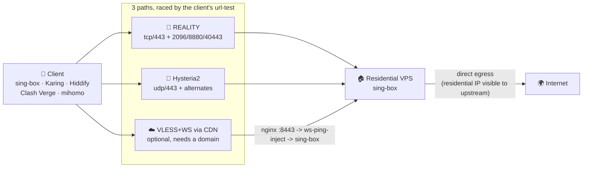
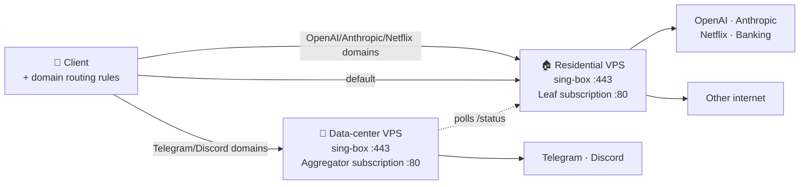

# anyreality-resi-stack

> [!IMPORTANT]
> **Legal Compliance & Acceptable Use Prerequisite**  
> This repository publishes pure Infrastructure-as-Code (IaC) configuration templates and automation scripts strictly for **authorized cross-region edge gateway operations, overseas localization QA, and WAN transport resilience research**. It **does not** provide, sell, host, or broker any VPS instances, IP addresses, bandwidth, proxy nodes, or commercial subscription services.  
> **Prohibited Use**: You **must not** deploy or use this software in jurisdictions with telecommunications or cross-border networking restrictions (including Mainland China without statutory international networking authorization) to establish unauthorized cross-border channels, evade regulatory controls, or operate shared/commercial VPN or proxy resale services. Users assume sole legal responsibility for compliance. Read the full notice before proceeding: [DISCLAIMER.md](DISCLAIMER.md).

**Self-hosted multi-path sing-box edge gateway & WAN transport resilience stack (residential & data-center split-egress routing)**

`anyreality-resi-stack` is an open-source (GPL-3.0), auditable **Bash one-line installer** that deploys **sing-box** on **Ubuntu 22.04+ / Debian 12+**, exposing three complementary paths by default — **VLESS + REALITY + Vision (TCP)**, **Hysteria2 (UDP)**, and **VLESS + WebSocket behind a CDN** (optional, needs a domain) — raced by the client. Plus a zero-dependency Python subscription server, usage cards, and dual-node domain routing. Entry point: [`install/install.sh`](install/install.sh).

> **Why three paths instead of one:** a single path will eventually fail under specific carrier QoS, CGNAT, or asymmetric routing conditions, and **when it does the server shows nothing wrong**. The three failure causes are uncorrelated. Full reasoning, controlled measurements, and methodology: **[Multi-Path Transport Resilience](docs/en/MULTIPATH-TRANSPORT.md)** — the core document of this project.

It is **not** a residential-IP vendor, multi-user panel, or hosted transit marketplace. You bring your own authorized server; this repo configures it.

[](https://github.com/qilaidev/anyreality-resi-stack/actions/workflows/lint.yml)
[](https://github.com/qilaidev/anyreality-resi-stack/actions/workflows/redact.yml)
[](LICENSE)
[](docs/en/DEPLOYMENT.md)
[](https://sing-box.sagernet.org)
[](docs/en/MULTIPATH-TRANSPORT.md)
[](https://github.com/qilaidev/anyreality-resi-stack/releases)

[简体中文 README](README.md) · [Disclaimer](DISCLAIMER.md) · [Multi-Path Transport](docs/en/MULTIPATH-TRANSPORT.md) · [Selective WARP](docs/en/WARP-EGRESS.md) · [Beginner guide](docs/en/BEGINNER_GUIDE.md) · [Examples](docs/en/EXAMPLES.md) · [FAQ](docs/en/FAQ.md) · [Deployment](docs/en/DEPLOYMENT.md) · [Clients](docs/en/CLIENTS.md) · [Routing](docs/en/ROUTING.md) · [Comparison](docs/en/COMPARISON.md) · [llms.txt](llms.txt) · [CodeMeta](codemeta.json) · [Changelog](CHANGELOG.md)

> English edition. The [Chinese README](README.md) is authoritative and updated first; `docs/en/` mirrors `docs/zh-CN/`.

## What / why / who

| | |
| --- | --- |
| **What** | Self-hosted edge gateway & transport **deployment stack**: installer + sing-box templates + tri-format subscription server + selective WARP egress + docs |
| **Problem** | Configure your authorized residential or DC VPS as an importable node; optional dual-node sends AI/streaming QA traffic via residential egress and Telegram/Discord via a DC fallback; optional `--with-warp` offloads 403-prone targets without polluting your clean residential IP |
| **Who** | Engineers and teams who own authorized servers, use SSH, and prefer Bash+systemd over a web panel |
| **Default protocol** | **VLESS + REALITY + Vision** — the only TLS-interoperable & active-probe-resistant protocol *every* client kernel can express; see [protocol choice](#protocol-choice-why-anyreality-is-no-longer-the-default) |
| **WAN transport resilience** | Three paths (TCP / UDP / CDN) plus alternate ports, raced by the client's url-test; adaptive tri-format subscription (`sing-box` / `Clash` / `URI`) |
| **Stack** | Bash, sing-box, REALITY, Hysteria2, VLESS+WS, AnyTLS (optional), Python stdlib HTTP, systemd, UFW, fail2ban, nginx (CDN path) |
| **OS** | Ubuntu 22.04+ / 24.04 LTS, Debian 12+ |
| **Paths** | `install/install.sh`; runtime `/etc/sing-box/conf`, `/etc/anyreality-resi-stack/`; metadata [llms.txt](llms.txt) · [codemeta.json](codemeta.json) |

**Two things first:** ① client profiles ship regional split-tunneling (local direct bypass) / ad-block / LAN-direct / WebRTC anti-leak rules for TUN with **100% inline rule-sets** ([routing](docs/en/ROUTING.md)); ② subscription is **plain HTTP :80** and contains the node credential — **the URL is a credential** ([SECURITY.md](SECURITY.md#subscription-url-exposure--订阅地址的暴露面)).

## Quick start

```bash
# Preview only
bash <(curl -fsSL https://raw.githubusercontent.com/qilaidev/anyreality-resi-stack/main/install/install.sh) \
  --node-name "US-Resi-01" --sni addons.mozilla.org --with-subscription --dry-run

# Install (default: vless-reality + Hysteria2 + alternate ports)
bash <(curl -fsSL https://raw.githubusercontent.com/qilaidev/anyreality-resi-stack/main/install/install.sh) \
  --node-name "US-Resi-01" \
  --sni addons.mozilla.org \
  --with-subscription
```

What it does: preflight + kernel tuning/swap → sing-box from official apt (GPG-pinned) → keys and per-path credentials → REALITY inbound on `:443` plus a Hysteria2 inbound on `udp:443` (self-signed cert, pinned in the profile) → alternate-port NAT redirects → systemd / UFW / fail2ban → optional CDN relay (nginx + WebSocket keepalive injector) → fetch and **inline** the rule-sets, generate all profile formats, validate them → self-check.

Add the CDN relay path (survives direct-origin route blackholing, severe peering loss, or strict egress firewalls):

```bash
... --cdn-domain relay.example.com --cdn-cert /path/fullchain.pem --cdn-key /path/key.pem
```

| Need | How |
| --- | --- |
| Pin version | `ANYREALITY_RESI_STACK_REF=<tag>` |
| Unattended | `--config FILE --non-interactive` |
| First time | [Beginner guide](docs/en/BEGINNER_GUIDE.md) |
| More recipes | [Examples](docs/en/EXAMPLES.md) |

Import the completion-card subscription URL with a **sing-box client** (SFA/SFI/SFM, Karing, Hiddify, NekoBox), then:

```bash
curl -x socks5h://127.0.0.1:2080 https://checkip.amazonaws.com
curl -fsS http://127.0.0.1/healthz   # run on the server (loopback-only by default)
systemctl status sing-box --no-pager
```

## Core features

- One-line install: `install/install.sh` (`--dry-run` / `--non-interactive` / `--config` / idempotent)
- Three complementary paths: REALITY (TCP) + Hysteria2 (UDP) + VLESS+WS via CDN (optional), auto-raced
- Alternate ports 2096/8880/40443 as NAT REDIRECTs to the main port — **zero sing-box config change**, mitigating per-port QoS throttling or middlebox shaping
- All rule-sets inlined: **no network at client startup**, which removes the boot deadlock entirely
- Optional AnyReality: `--protocol anytls-reality` — stronger padding, at the cost of no Clash profile
- Three-ecosystem adaptive subscription: `subscription/leaf_server.py` serves `profile.json` (sing-box), `profile.yaml` (Clash/mihomo with anti-leak `dns:`, `respect-rules: true`, and `packet-encoding: xudp`), or `profile.txt` (Base64 multi-path URI bundle for Shadowrocket / v2rayN / v2rayNG / Streisand) from a single `/<TOKEN>/` URL via User-Agent detection or `?format=singbox|clash|uris`, plus `?allow_webrtc=1`, `/status`, loopback `/healthz`, and usage cards
- Server-side selective WARP egress: `--with-warp` ([WARP-EGRESS](docs/en/WARP-EGRESS.md)) attaches a native sing-box WireGuard endpoint (`warp-ep`) with 10-stage C9 route invariants (including pre-/post-resolve private-IP SSRF guards) and a 2-minute auto-degrade/recover watchdog (`warp-watchdog.timer`), routing only Turnstile/403-challenged AI/social domains and the AAAA-only `challenges.cloudflare.com` widget via WARP while keeping Google/Netflix/TikTok/banking on your native residential IP
- Ready-made anti-leak routing: LAN direct → ad block → default WebRTC STUN leak block (`--allow-webrtc` or `?allow_webrtc=1` opt-out) → priority overseas AI/social/GitHub/TG rules → regional split-tunneling (`REGIONAL_SAFETY_NET` inline bypass + regional CDN suffixes + geosite/geoip) → reject UDP/443 → proxy
- Dual-node: residential for OpenAI/Anthropic/Netflix; DC for Telegram/Discord ([DUAL-NODE](docs/en/DUAL-NODE.md))
- Ops defaults: systemd (`apt-mark hold sing-box` against unattended-upgrades breakage), UFW (auto-detecting active SSH ports + pinned Cloudflare IPv4/IPv6 origin-pull fallback), nginx `ssl_reject_handshake on` SNI stealth on CDN origins, fail2ban, BBR + UDP/QUIC socket buffer tuning & GRO/GSO offload, dual-stack `iptables`/`ip6tables` port redirects, swap, backup timer, and deep health checks (including C3 drift and C9 WARP audits)
- Safety: per-host secrets; redact + optional high-entropy hash denylist in CI

## Use cases

| Scenario | Recommendation |
| --- | --- |
| Authorized residential VPS for localization QA, AI API, or streaming reputation | This stack, single node + subscription |
| Residential works for AI but TG/Discord uploads stall | [Dual-node](docs/en/DUAL-NODE.md) |
| Single-instance, no panel, auditable edge gateway | This stack |
| Multi-user billing / web admin API | Out of scope (evaluate dedicated multi-tenant panels such as 3x-ui / x-ui separately) |
| Must use Clash/mihomo | The default already works — no extra flag |
| Shadowrocket / v2rayN / v2rayNG | Same subscription URL auto-serves Base64 multi-path URIs (or append `?format=uris`) |
| Claude/ChatGPT/X 403 challenge or IPv4-only Turnstile deadlock | Add `--with-warp` for [selective server-side WARP egress](docs/en/WARP-EGRESS.md) |
| Direct origin unreachable (strict CGNAT / cellular / peering loss) | Add `--cdn-domain` for the CDN relay path |

### Deployer Comparison

> Full rubric and scenario scores: [COMPARISON.md](docs/en/COMPARISON.md). Protocol comparison: next section.

| Stack | Architecture | Protocols & Subscription | Dual-Node & Selective WARP | Hygiene & Testability | Best For |
|---|---|---|---|---|---|
| **anyreality-resi-stack** | **Panel-free · Bash + systemd** | VLESS+REALITY + Hysteria2 + WS+CDN; adaptive tri-format subscription | Built-in residential/DC split + 10-stage `--with-warp` | `redact.sh` secret hygiene + 126 stdlib unit tests | Residential VPS, AI/QA workflows, long-lived self-hosting |
| **Generic single-script menu installers** | Panel-free install scripts | Single-script multi-protocol defaults | Manual JSON editing for split egress / WARP | No shared secret scan or offline unit tests | Quick single-VPS experiments |
| **3x-ui / x-ui** | Web UI + SQLite | Broad protocol UI coupled to web port | Manual outbound rules | Larger web admin surface | Users wanting a GUI dashboard |
| **Hand-rolled sing-box** | Manual JSON + systemd | Maximum flexibility | Fully manual rules and certs | Brittle across upgrades or remote rule-sets | Custom debugging specialists |

## Limits

- Does **not** sell VPS/IPs/bandwidth; no multi-user billing, commercial proxy panel, K8s/Docker-only/OpenWRT/CentOS 7
- **Strictly prohibited** for unauthorized cross-border channels, commercial proxy resale, multi-user sharing, or unlawful activity (see [DISCLAIMER.md](DISCLAIMER.md))
- Does **not** claim to bypass account risk controls, regional policy, or carrier filtering
- `--protocol anytls-reality` is **unsupported** by mihomo/most Clash (the installer refuses to emit a Clash profile rather than emitting a broken one); **never share** the subscription URL
- The CDN relay path needs **your own domain, certificate and CDN account** — not provided here

**GitHub About:** `Self-hosted multi-path sing-box edge gateway & WAN transport resilience stack — VLESS-REALITY + Hysteria2 + CDN relay, dual-node routing, selective WARP, tri-format subscription.`  
**GitHub Topics:** `sing-box` `vless-reality` `hysteria2` `residential-proxy` `cloudflare-warp` `wireguard` `mihomo` `clash` `v2rayn` `proxy-subscription` `self-hosted` `edge-infrastructure` `systemd` `linux` `ubuntu` `debian`

Compliance notice: [DISCLAIMER.md](DISCLAIMER.md) · AI summary: [llms.txt](llms.txt) · Machine-readable metadata: [codemeta.json](codemeta.json) · Docs index: [docs/README.md](docs/README.md)

## Why this exists

Most generic VLESS scripts target low-cost servers for hiding exit IPs. **Residential VPS is the opposite:** you paid for egress reputation (localization QA, OpenAI API, banking, streaming), yet the same subnet may be soft-throttled by Telegram or Discord. This project treats the residential IP as an operational asset and routes hostile services around it. Dual-node steps: [DUAL-NODE.md](docs/en/DUAL-NODE.md).

## After install

Completion card: node info, per-path credentials (the `vless://` share link, the Hysteria2 password), subscription `http://<IP>/<SUB_TOKEN>/`. **Prefer the subscription, not the bare `vless://`** — the share link describes only the direct REALITY path and carries no Hysteria2, no CDN relay, no alternate ports, no automatic failover and no routing rules. Samples under `examples/`. Manual fields and clients: [CLIENTS.md](docs/en/CLIENTS.md). Verify with the `curl` commands above. Troubleshooting: [TROUBLESHOOTING.md](docs/en/TROUBLESHOOTING.md).

## Protocol choice: why AnyReality is no longer the default

> **The first question when choosing a protocol is not "which is fastest" but
> "can every client kernel I need to support express this node?"** This project
> asked them in the wrong order and paid a month for it.

### What happened

This repository used to default to **AnyTLS + REALITY**, and the argument was
sound: custom padding smooths nested-TLS signatures, REALITY eliminates
certificate provisioning overhead, and weak-link throughput outperformed classic
TLS tunnels. **The conclusion was still wrong.**

The reasoning was fine. The mistake was looking only at the server and never at
client kernel coverage:

> mihomo's `anytls` block has **no `reality-opts` field**, so there is nowhere
> to put `public-key` / `short-id`
> ([docs](https://wiki.metacubex.one/en/config/proxies/anytls/) ·
> [issue #2155](https://github.com/MetaCubeX/mihomo/issues/2155)).
> In a Clash-family subscription **the primary node cannot be written down at
> all.**

The shape is worth memorising: server entirely green, `sing-box check` passing,
sing-box users perfectly fine — and **only Clash users with no primary node,
seeing "a few nodes missing from the list" rather than any error.** Nothing on
the server side indicated a problem, which is why it took a month to find.

### The default today

| | Default | Opt-in |
|---|---|---|
| **Protocol** | `--protocol vless-reality` (VLESS + REALITY + xtls-rprx-vision) | `--protocol anytls-reality` |
| **Client coverage** | sing-box family ✅ · Clash / mihomo ✅ | sing-box family ✅ · Clash / mihomo ❌ |
| **TLS interoperability & probe resistance** | REALITY server camouflage, no domain or cert | REALITY + AnyTLS padding (the padding really is stronger) |
| **Subscription output** | `profile.json` + `profile.yaml` | **`profile.json` only** |

AnyReality's padding is a genuine advantage and it has not been removed. But
choosing it means **no Clash profile** — the installer says so and
`build_profile.py` refuses to emit YAML rather than emitting a crippled one.
That is deliberate: silently leaving half your users without a node is far worse
than a loud error.

### 30-second decision tree

```text
Is any of my clients Clash / mihomo / Stash?
  ├─ Yes (or not sure) → vless-reality (the default; leave it)
  └─ All sing-box family, and certain no Clash client will be added
        → anytls-reality is available, for stronger padding
           Cost: JSON-only subscription; adding one Clash user later means reinstalling

Lossy link, UDP passes?                    → the Hysteria2 path is on by default
Direct-origin route blackholed/firewalled? → the CDN relay path is required; see docs/en/MULTIPATH-TRANSPORT.md
Already have domain + cert + proxy?        → Trojan/TLS works, heavier to run; out of scope here
```

### Protocol comparison

Scenario fixed as: **Cross-region WAN resilience · self-hosted edge gateway · TLS handshake interoperability & active-probe resistance · minimal domain/certificate overhead.** This is a product judgement, not a lab benchmark, and not a guarantee against carrier filtering.

| Protocol | Client coverage | Interoperability & active-probe resistance | Domain-free | Role here |
|---|---|---|---|---|
| **VLESS + REALITY + Vision** | **sing-box + mihomo** | High (REALITY TLS handshake borrowing) | ✅ | **Default primary path** |
| AnyTLS + REALITY | sing-box family only | Higher (padding + handshake borrowing) | ✅ | `--protocol anytls-reality` |
| **Hysteria2** | sing-box + mihomo | Medium (salamander obfs) | Self-signed is enough — pinned for you | **Default second path** (UDP) |
| **VLESS + WebSocket + CDN** | sing-box + mihomo | Medium (CDN terminates TLS; sees cleartext header) | Needs domain + cert | **Optional third path**; survives direct-origin route blackholing or strict firewalls |
| Trojan / classic TLS | Broad | Medium | ❌ needs a domain and a real site | Not shipped (heavier ops, no borrowed fingerprint) |
| Shadowsocks 2022 | Broad | Low (weak TLS-layer camouflage) | ✅ | Not shipped |
| VMess | Broad | Low (legacy characteristics) | ✅ | Not shipped |

> **Hysteria2 is not a REALITY replacement — it is a different lane.** It runs
> over UDP/QUIC: it often still passes when TCP is throttled or stalled, and
> some cellular or enterprise networks drop UDP ranges. Both are shipped precisely
> because their failure causes are uncorrelated.

### Which path saves you, and when

| Path | Transport | When it is the only one that works | When it is degraded |
|---|---|---|---|
| REALITY | tcp/443 + 2096/8880/40443 | Clean fixed-broadband routes; zero relay hop overhead | Strict middleboxes or cellular CGNAT: SYN passes, ClientHello stalled |
| Hysteria2 | udp/443 + alternates | TCP congestion collapse; high-loss trans-oceanic links | Enterprise or cellular paths dropping sustained UDP |
| CDN relay | tcp/443 → Anycast CDN → origin | **Survives direct-origin route blackholing, severe peering loss, or strict egress firewalls** | Needs a domain; adds one hop |

Controlled measurements (220 ms trans-Pacific broadband benchmark, TUN bypassed, cross-polled), why direct
REALITY is not in the `⚡ Auto` group, how to choose edge IPs, and the full
measurement methodology: **[Multi-Path Transport Resilience](docs/en/MULTIPATH-TRANSPORT.md)**.

### Keeping up with upstream

Protocol ecosystems, middlebox behaviour, and client support all change. Defaults here
track [sing-box](https://sing-box.sagernet.org/) / REALITY / mihomo upstream and
are recorded in the [Changelog](CHANGELOG.md). If mihomo ever gains
`reality-opts` for `anytls`, the default will be re-evaluated — but **the
criterion stays "can every target client kernel express it", not raw
performance.**

### Boundaries

- This project makes **no claim** about bypassing account risk controls, regional
  policy, or carrier filtering.
- Multi-path improves the **probability that one path still works** when another
  fails. It is not absolute availability.
- All three paths still require your server to be online. If the origin IP is unreachable on a path
  and no CDN domain is configured, this project cannot help you.

## Architecture

### Single-node (default)



The three failure causes are uncorrelated: REALITY stalls under middlebox ClientHello
interference on TCP, Hysteria2 drops under blanket UDP filtering, and the CDN relay only
depends on a domain and certificate — while being **the only path that survives direct-origin
route blackholing or strict egress firewalls**. Group ordering, probe parameters, and why direct
REALITY is kept out of the auto group: [Multi-Path Transport Resilience §4](docs/en/MULTIPATH-TRANSPORT.md).

### Dual-node with smart routing



The client downloads a *single* subscription URL from the aggregator. That URL returns a profile
listing **both** nodes plus the routing rules. The server picks the format from the client's
User-Agent — sing-box JSON for SFA/Karing/Hiddify, Clash YAML for mihomo/Stash — so one URL serves
heterogeneous client devices. Traffic
accounting still reflects the residential node's quota: the aggregator polls the leaf and caches the
result, degrading gracefully if the leaf is briefly unreachable.


## Security

- All secrets are generated per-server and never committed.
- Repository CI gates on an optional high-entropy hash denylist plus a secret-shape detector — no UUID or Reality key can land in a PR.
- The sing-box apt repository is verified against a pinned GPG fingerprint; installation refuses to
  proceed on mismatch.
- Threat model, secret policy, and legal boundary: [SECURITY.md](SECURITY.md) · [DISCLAIMER.md](DISCLAIMER.md).

> ⚠️ **The subscription URL is a credential.** The subscription server is plain HTTP on `:80` and
> the profile returned by `http://<ip>/<SUB_TOKEN>/` contains your node password — anyone on the
> path can read it, and anyone who learns the URL has your node. Do **not** paste the full URL into
> issues, screenshots, or chat groups, and do **not** put backup files into `FILE_DIR` (the same
> token path would serve them). For stronger protection, front it with a TLS reverse proxy (or pass
> `--sub-tls-cert` / `--sub-tls-key`), or fetch the profile once over `scp` and disable the
> subscription server. Full write-up in
> [SECURITY.md](SECURITY.md#subscription-url-exposure--订阅地址的暴露面).

## FAQ

The highest-frequency questions are below. The full set — 40+ answers covering installer flags,
subscription security, usage accounting, routing behaviour, dual-node, uninstall, compliance, and
license boundaries — lives in [docs/en/FAQ.md](docs/en/FAQ.md).

**Telegram file uploads stall on my residential VPS — "sending…" spins forever. What now?**
Telegram soft-throttles residential subnets that have historically hosted bots. Enable **dual-node
mode** and route `geosite:telegram` out through the data-center node; the problem goes away.

**OpenAI says "unsupported region" on my data-center VPS, but Telegram gets slow on the residential
one. How do I get both?**
That is the entire reason this project exists: OpenAI / Anthropic / banking / Netflix leave through
the residential exit, Telegram / Discord leave through the data-center node, and the client only
ever sees one subscription.

**What is the default protocol, and why not AnyReality?**
The default is **VLESS + REALITY + xtls-rprx-vision**, because it is the only TLS-interoperable,
active-probe-resistant protocol that **both sing-box and mihomo can express**. AnyReality's padding
really is stronger, but mihomo's `anytls` block has no `reality-opts` field — that node cannot be
written into a Clash profile at all, while **the server stays green and sing-box users notice
nothing**. That trap cost this project a month. If you want the padding and are certain every client
is sing-box family, use `--protocol anytls-reality`; the installer will tell you plainly that there
is no Clash profile. Full argument: [protocol choice](#protocol-choice-why-anyreality-is-no-longer-the-default).

**My direct origin IP is unreachable on a strict CGNAT / cellular path and changing ports does not
help. Now what?**
Add the **CDN relay path**: `--cdn-domain relay.example.com --cdn-cert … --cdn-key …`, with the
domain proxied through an Anycast CDN such as Cloudflare. It is the fallback path that survives
direct-origin route blackholing or strict egress firewalls. Two things to know: the origin port cannot
be 443 (sing-box owns it, and REALITY forwards non-proxy traffic verbatim to its handshake target),
so the installer accepts only the ports a CDN pulls from over HTTPS; and the CDN closes a proxied
WebSocket after ~100 s of no frames, which TCP keepalive cannot prevent because it is hop-by-hop.
This stack injects application-level WebSocket pings at the origin — see
[Multi-Path Transport Resilience §5](docs/en/MULTIPATH-TRANSPORT.md).

**The client quits the instant I open it, or will not start after boot. Rebooting sometimes helps.**
Almost certainly a **remote rule-set deadlocking startup on the proxy**: sing-box downloads every
`type: remote` rule-set before it finishes starting and a failure is fatal — and the download goes
through a proxy group that, on a cold start, has no measurements and simply uses its first member,
which on your line is dead. Profiles from this project **inline every rule-set, so startup makes no
network request at all** and cannot fail this way. If it still happens, look for an **old
subscription from a decommissioned server** still sitting in the client; it brings the loop back.
Check with `grep -c raw.githubusercontent <client kernel.log>`.

**I just imported the subscription and now local/regional sites are slow. Is the node broken?**
No. In TUN mode there is no "global / direct" switch — routing rules alone decide what is proxied,
and incomplete rules push regional traffic across the remote gateway (hairpinning). The profile this
project generates ships four rule layers (LAN-direct → ad-block → regional split-tunneling → proxy
fallback) and works on import. If you hand-edited the config or used a template from elsewhere, check
it against [routing rules](docs/en/ROUTING.md). Note that this project **inlines every rule-set into
the profile** — the download happens weekly on the server, never in the client at startup — plus an
inline `REGIONAL_SAFETY_NET` domain bypass that depends on no download at all.

**Is the subscription URL HTTPS? Can I share it?**
No — it is plain HTTP on `:80`, and the profile contains your node password. **Whoever has the URL
has your node.** Never share it publicly, paste it into an issue, or screenshot it. Add your own TLS
reverse proxy (or use `--sub-tls-cert` / `--sub-tls-key`), or fetch the profile once with `scp` and
shut the subscription server down. Also keep backup files out of `FILE_DIR`, since the same token
path would serve them. See [SECURITY.md](SECURITY.md#subscription-url-exposure--订阅地址的暴露面).

**Does Reality need a domain and a certificate?**
Neither the REALITY nor the Hysteria2 path does — that is the biggest advantage over Trojan /
V2Ray-TLS. The default camouflage SNI is `addons.mozilla.org`, swappable for any high-reputation
domain. Hysteria2 uses a self-signed certificate generated by the installer and **pinned in the
profile** rather than a client-side `skip-cert-verify`, so it needs no domain and does not weaken
verification. **Only the optional CDN relay path needs your own domain and certificate.**

**Why does the default config block UDP 443 (QUIC / HTTP3)?**
REALITY and the CDN relay are TCP-only, so that QUIC traffic cannot traverse them. Left unblocked,
browsers retry HTTP/3 and only fall back to TCP after a timeout — which users experience as "pages
hang for a few seconds first". Blocking `udp:443` forces the fallback immediately. Note the rule
matches **client traffic**, not the tunnel: Hysteria2 itself runs over UDP and is unaffected. Pass
`--allow-quic` at install time to keep QUIC.

**How is this different from web panels (3x-ui / x-ui) or generic single-script installers?**
Those are built for multi-user hosting or low-cost generic tunnels that hide the exit IP. This
project is built on the opposite premise — **your static residential IP is an operational asset** —
so it defaults to a single credential, does not hide the IP, diverts only the few services hostile
to residential subnets, and is strictly scoped to authorized infrastructure operations and WAN research.

The rest — installer idempotency, why only Ubuntu 22.04+ / Debian 12+, pinning versions and
unattended installs, recovering a lost subscription URL, usage-accounting semantics, dual-node
deployment, uninstall and rollback, compliance & GPL-3.0 boundaries — is answered in the
[full FAQ](docs/en/FAQ.md).

## Documentation

| Guide | Link |
| --- | --- |
| **Legal Compliance & Disclaimer** | **[DISCLAIMER.md](DISCLAIMER.md)** |
| Documentation index | [docs/README.md](docs/README.md) |
| **Multi-Path Transport Resilience (core)** | **[docs/en/MULTIPATH-TRANSPORT.md](docs/en/MULTIPATH-TRANSPORT.md)** |
| Beginner guide | [docs/en/BEGINNER_GUIDE.md](docs/en/BEGINNER_GUIDE.md) |
| FAQ | [docs/en/FAQ.md](docs/en/FAQ.md) |
| Usage examples | [docs/en/EXAMPLES.md](docs/en/EXAMPLES.md) |
| Deployment | [docs/en/DEPLOYMENT.md](docs/en/DEPLOYMENT.md) |
| Subscription server design | [docs/en/SUBSCRIPTION.md](docs/en/SUBSCRIPTION.md) |
| Dual-node + smart routing | [docs/en/DUAL-NODE.md](docs/en/DUAL-NODE.md) |
| Selective WARP egress & watchdog | [docs/en/WARP-EGRESS.md](docs/en/WARP-EGRESS.md) |
| Client routing rules | [docs/en/ROUTING.md](docs/en/ROUTING.md) |
| Client import | [docs/en/CLIENTS.md](docs/en/CLIENTS.md) |
| Troubleshooting | [docs/en/TROUBLESHOOTING.md](docs/en/TROUBLESHOOTING.md) |
| Comparison with similar tools | [docs/en/COMPARISON.md](docs/en/COMPARISON.md) |
| Operations runbook | [docs/en/OPERATIONS.md](docs/en/OPERATIONS.md) |

For AI search engines and retrieval tools, see [llms.txt](llms.txt) — a compact machine-readable
summary of the project purpose, compliance boundaries, docs map, and useful search phrases.

## Contributing

PRs welcome. Read [CONTRIBUTING.md](CONTRIBUTING.md) and [DISCLAIMER.md](DISCLAIMER.md) first — lint gates are strict, and any change
touching install scripts must pass `make test && make lint && make redact && make examples`.

## License

GPL-3.0. See [LICENSE](LICENSE).

<details>
<summary>Search Intent &amp; Query Mapping</summary>

| Search Intent | Representative Queries | Target Capability |
|---|---|---|
| Residential VPS sing-box deployer | `sing-box residential ip vless reality installer`, `self-hosted edge stack` | `install/install.sh` default VLESS+REALITY+Vision on Ubuntu/Debian + systemd |
| Dual-node AI & messaging split routing | `openai residential ip telegram dc egress routing`, `sing-box dual-node egress` | Primary residential + secondary DC `--secondary-host` native rule-set routing |
| 403 / Turnstile mitigation without IP pollution | `sing-box selective warp egress cloudflare 403`, `with-warp exclude direct` | `--with-warp` 10-stage C9 WARP routing (`scripts/warp_egress.py` + `EXCLUDE_DIRECT`) |
| Multi-path WAN & strict CGNAT fallback | `vless reality hysteria2 cdn websocket fallback`, `sing-box urltest multi-path` | 3 paths (TCP REALITY + UDP Hysteria2 + WS CDN) with client `urltest` racing |
| Panel-free multi-client subscription | `sing-box mihomo v2rayn subscription server`, `tri-format subscription` | Stdlib Python HTTP (`?format=singbox\|clash\|uris`), TLS option, gzip compression |
| Panel alternative with secret audit | `alternative to 3x-ui bash systemd`, `sing-box comparison` | [COMPARISON.md](docs/en/COMPARISON.md) + `scripts/redact.sh` secret hygiene + 126 unit tests |

</details>

---

**Search keywords**: sing-box multi-path installer, VLESS Reality Hysteria2 CDN relay, sing-box
multi-path WAN resilience, AnyReality, AnyTLS Reality, residential IP egress, VLESS Reality
residential proxy, sing-box residential installer, self-hosted edge infrastructure, Cloudflare WebSocket
idle timeout keepalive, sing-box remote rule-set FATAL startup, inline rule-set sing-box,
Cloudflare preferred IP end-to-end, alternate port iptables REDIRECT, OpenAI residential IP exit,
Telegram residential IP slow upload, Clash domain routing, dual-node smart routing,
alternative to 3x-ui for residential VPS, selective WARP egress, sing-box subscription server.

---

## Architecture & Ecosystem · qilai (`qilaidav.com`)

This repository is part of the **[qilai · qilaidav](https://qilaidav.com/)** deterministic systems engineering matrix:

- **Corresponding Architecture Pillar**: [Global Edge & Deterministic Infrastructure](https://qilaidav.com/en/cloud-matrix/) · [中文架构页](https://qilaidav.com/cloud-matrix/)
- **AI & Machine-Readable Metadata**: [llms.txt](llms.txt) · [codemeta.json](codemeta.json)
- **Studio Website (EN / ZH)**: [https://qilaidav.com/en/](https://qilaidav.com/en/) · [https://qilaidav.com/](https://qilaidav.com/)
- **Production Field Reports & Technical Notes**: [https://qilaidav.com/notes/](https://qilaidav.com/notes/)
- **Direct Architect Contact (Telegram)**: [@BD8888](https://t.me/BD8888)
- **Public Technical Channel (Telegram)**: [@AIKB8 · AI资源笔记](https://t.me/AIKB8)
- **Email**: [hello@qilaidav.com](mailto:hello@qilaidav.com)
