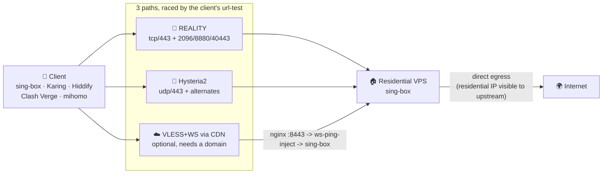
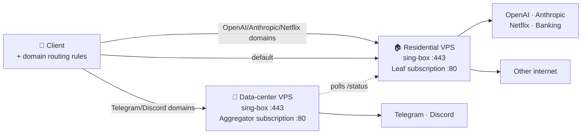

# anyreality-resi-stack

> [!IMPORTANT]
> **法律合规与授权使用声明 / Legal Compliance & Acceptable Use**  
> 本仓库仅为面向**合法授权跨区域边缘网关运维、海外业务本地化 QA 与广域网弱网传输容灾研究**的基础设施即代码（IaC）本地配置工具，**不提供、不销售、不托管**任何服务器、IP、带宽、节点或商业订阅服务。  
> **严禁**在受国际联网及通信行业监管限制的司法管辖区（包括中国大陆境内未取得法定国际联网信道资质的个人或单位）用于建立非法定跨境信道、规避网络监管或向第三方提供代理/VPN 经营与共享服务。使用者须自行核实并承担全部适用法律法规与合规责任，部署或审阅前请务必阅读完整条款：[DISCLAIMER.md](DISCLAIMER.md)。

**面向跨区域弱网容灾与出口信誉管理的 sing-box 多路径自托管边缘部署栈（静态住宅与数据中心双栈路由）**  
**Self-hosted multi-path sing-box edge gateway & WAN transport resilience stack (residential & data-center split-egress routing)**

**Language**: 简体中文 · [English README](README.en.md) · [合规与免责声明](DISCLAIMER.md)

`anyreality-resi-stack` 是一个开源（GPL-3.0）、可审计的 **Bash 一键安装工具包**：在 **Ubuntu 22.04+ / Debian 12+** 自有服务器上部署 **sing-box**，默认同时开三条互补的传输路径 —— **VLESS + REALITY + Vision（TCP）**、**Hysteria2（UDP）**、**VLESS + WebSocket 经 CDN 中转（可选，需域名）**，由客户端自动赛跑选路；可选启用零依赖 Python 订阅服务、流量卡片与双节点域名分流。入口：[`install/install.sh`](install/install.sh)。

> **为什么是三条路而不是一条**：在异构广域网中，单一路径必然会在某些链路的 QoS、CGNAT 或非对称路由下失效，而且**失效时服务端完全看不出来**。
> 三条路径的失效原因互不相关 —— 完整论证、受控实测数据与端到端测量方法见
> **[多路径传输容灾、弱网调优与端到端测量方法论](docs/zh-CN/MULTIPATH-TRANSPORT.md)**，这份文档是本项目的核心。

It is **not** a residential-IP vendor, multi-user panel, or hosted transit marketplace. You bring your own authorized server; this repo configures it.

[](https://github.com/qilaidev/anyreality-resi-stack/actions/workflows/lint.yml)
[](https://github.com/qilaidev/anyreality-resi-stack/actions/workflows/redact.yml)
[](LICENSE)
[](docs/en/DEPLOYMENT.md)
[](https://sing-box.sagernet.org)
[](docs/zh-CN/MULTIPATH-TRANSPORT.md)
[](https://github.com/qilaidev/anyreality-resi-stack/releases)

[English README](README.en.md) · [合规免责](DISCLAIMER.md) · [多路径传输与弱网调优](docs/zh-CN/MULTIPATH-TRANSPORT.md) · [选择性 WARP](docs/zh-CN/WARP-EGRESS.md) · [新手教程](docs/zh-CN/BEGINNER_GUIDE.md) · [命令示例](docs/zh-CN/EXAMPLES.md) · [FAQ](docs/zh-CN/FAQ.md) · [部署](docs/zh-CN/DEPLOYMENT.md) · [客户端](docs/zh-CN/CLIENTS.md) · [分流规则](docs/zh-CN/ROUTING.md) · [同类对比](docs/zh-CN/COMPARISON.md) · [llms.txt](llms.txt) · [CodeMeta](codemeta.json) · [Changelog](CHANGELOG.md)

---

## 项目定位 | What / why / who

| | 中文 | English |
|---|---|---|
| **是什么** | 自托管边缘网关与传输**部署栈**：安装器 + sing-box 模板 + 三格式订阅服务 + 选择性 WARP 出站 + 文档 | Self-hosted edge gateway & transport **deployment stack**: installer, sing-box templates, tri-format subscription server, selective WARP egress, docs |
| **解决什么** | 把自有静态住宅/数据中心主机配成可导入客户端的合规边缘节点；可选双节点把 AI API / 流媒体 QA 等走住宅出口、即时通讯走数据中心；可选 `--with-warp` 让弹 403/验证的目标走 WARP 而不污染原生住宅 IP | Configure your authorized residential or DC VPS as an importable node; optional dual-node routes AI/streaming QA traffic via residential egress and IM via DC; optional `--with-warp` protects clean residential IPs |
| **适合谁** | 自有合法合规服务器、会 SSH、不想维护 Web 面板的工程师/团队 | Owners of authorized servers who prefer Bash+systemd over a web panel |
| **默认协议** | **VLESS + REALITY + Vision** —— 唯一一个 sing-box 与 mihomo **都能表达**且具备协议栈兼容性与抗主动探测能力的传输协议；论证见 [协议选型](#协议选型为什么默认不是-anyreality) | **VLESS + REALITY + Vision**; the only TLS-interoperable & active-probe-resistant protocol every client kernel can express |
| **多路径容灾** | 三条路径（TCP / UDP / CDN）＋ 备用端口，客户端 urltest 自动选路；三格式自适应订阅（`profile.json` / `profile.yaml` / `profile.txt`） | Three paths (TCP / UDP / CDN) plus alternate ports, raced by the client; adaptive tri-format subscription (`sing-box` / `Clash` / `URI`) |
| **技术栈** | Bash, sing-box, REALITY, Hysteria2, VLESS+WS, AnyTLS(可选), Python stdlib HTTP, systemd, UFW, fail2ban, nginx(CDN 路径) | same |
| **系统** | Ubuntu 22.04+/24.04, Debian 12+ | same |
| **入口路径** | `install/install.sh`；运行时 `/etc/sing-box/conf`, `/etc/anyreality-resi-stack/`；元数据 [llms.txt](llms.txt) · [codemeta.json](codemeta.json) | same |

**先知道的三件事：** ① 客户端配置自带本地/区域直连分流、广告拦截与 WebRTC 防泄漏规则，且**全部规则集内嵌、启动期零网络请求**（远程规则集会让客户端在抖动线路上开机卡死，见 [多路径传输与弱网调优](docs/zh-CN/MULTIPATH-TRANSPORT.md)）；② 订阅默认 **明文 HTTP :80**，URL 含节点凭据，**等同凭证，勿外传**（[SECURITY.md](SECURITY.md#subscription-url-exposure--订阅地址的暴露面)）；③ CDN 中转路径需要你自己的域名和证书，不配也能用，但**当源站直连路由出现黑洞、跨网严重丢包或严格防火墙隔离时，这是唯一稳定连通的兜底通路**。

## 快速开始 | Quick start

```bash
# 建议先 dry-run 预览（不改系统）
bash <(curl -fsSL https://raw.githubusercontent.com/qilaidev/anyreality-resi-stack/main/install/install.sh) \
  --node-name "US-Resi-01" --sni addons.mozilla.org --with-subscription --dry-run

# 确认无误后去掉 --dry-run 正式安装（默认 vless-reality + Hysteria2 + 备用端口）
bash <(curl -fsSL https://raw.githubusercontent.com/qilaidev/anyreality-resi-stack/main/install/install.sh) \
  --node-name "US-Resi-01" \
  --sni addons.mozilla.org \
  --with-subscription
```

安装器会：预检与内核调优/swap → 官方 apt 源装 sing-box（GPG 校验）→ 生成密钥与各路径口令 → 写 REALITY 入站（`:443`）＋ Hysteria2 入站（`udp:443`，自签证书并在订阅里钉住）→ 备用端口 NAT 重定向 → systemd / UFW / fail2ban → 可选 CDN 中转（nginx + WS 保活注入）→ 拉取并**内嵌**规则集、生成三态订阅并做结构校验 → 自检。

想加 CDN 中转路径（源站直连路由不可达或严格防火墙隔离时的兜底通路）：

```bash
... --cdn-domain relay.example.com --cdn-cert /path/fullchain.pem --cdn-key /path/key.pem
```

| 需求 | 做法 |
|---|---|
| 固定版本可重复部署 | `ANYREALITY_RESI_STACK_REF=<tag>` |
| 无人值守 | `--config FILE --non-interactive` |
| 第一次部署 | [新手教程](docs/zh-CN/BEGINNER_GUIDE.md) / [Beginner guide](docs/en/BEGINNER_GUIDE.md) |
| 更多命令 | [命令示例](docs/zh-CN/EXAMPLES.md) |

装完用完成卡上的订阅 URL（`http://<IP>/<TOKEN>/`）导入 **sing-box 系客户端**（SFA/SFI/SFM、Karing、Hiddify、NekoBox），再验证：

```bash
curl -x socks5h://127.0.0.1:2080 https://checkip.amazonaws.com   # 客户端侧，应等于授权服务器出口
curl -fsS http://127.0.0.1/healthz                        # 服务端本机检查订阅存活（外网默认 404）
systemctl status sing-box --no-pager
```

## 核心功能 | Core features

- **一行安装**：`install/install.sh`（`--dry-run` / `--non-interactive` / `--config` / 幂等重跑）
- **三条互补路径**：REALITY(TCP) ＋ Hysteria2(UDP) ＋ VLESS+WS 经 CDN（可选），客户端 urltest 自动选路
- **备用端口**：2096/8880/40443 用 NAT REDIRECT 打到主口，**sing-box 配置零改动**，应对按端口施行的 QoS 限速或中间盒策略
- **规则集全内嵌**：启动期零网络请求，杜绝「客户端一点就退」的开机死锁；服务端每周刷新
- **可选 AnyReality**：`--protocol anytls-reality`，填充更强，代价是没有 Clash 订阅
- **三态自适应订阅**：`subscription/leaf_server.py`（零依赖），一个 `/<TOKEN>/` 地址根据 User-Agent（或 `?format=singbox|clash|uris`）自动向 sing-box 系下发 `profile.json`、向 Clash/mihomo 系下发 `profile.yaml`（含防泄漏 `dns:` + `respect-rules: true` + `packet-encoding: xudp`）、向 Shadowrocket/v2rayN/v2rayNG/Streisand 下发 Base64 全路径节点包 `profile.txt`，支持 `?allow_webrtc=1` 按需放行 WebRTC、`/status`、本机 `/healthz` 与 `Subscription-Userinfo` 流量卡片
- **服务端选择性 WARP 出站**：`--with-warp`（[WARP-EGRESS](docs/zh-CN/WARP-EGRESS.md)），在 `sing-box` 内挂载原生 WireGuard Endpoint (`warp-ep`) 与 10 级 C9 路由不变量（含解析前后双层私网防 SSRF），仅将弹 403/Turnstile 的 AI/社交域名及纯 AAAA 的 `challenges.cloudflare.com` 切入 WARP，保留 Google/Netflix/TikTok/网银 100% 原生住宅 IP 直出，并配每 2 分钟自愈 `warp-watchdog.timer`
- **开箱分流与防泄漏**：内网直连 → 广告拦截 → 默认封堵 WebRTC STUN 端口防住宅 IP 旁路泄漏（可 `--allow-webrtc` 或 `?allow_webrtc=1` 关闭）→ 高优海外业务（AI/GitHub/IM）分流 → 本地/区域直连分流（`REGIONAL_SAFETY_NET` 内联安全网 + 区域常用 CDN 扩展后缀 + geosite/geoip，防 TUN 模式跨洋折返）→ 拦 UDP/443 → 其余走节点
- **双节点**：静态住宅节点承载 OpenAI/Anthropic/Netflix 等信誉敏感 QA 流量；数据中心节点承载 Telegram/Discord（[DUAL-NODE](docs/zh-CN/DUAL-NODE.md)）
- **运维默认**：systemd（`apt-mark hold sing-box` 防后台静默升级破坏配置）、UFW（自动识别当前活跃 SSH 端口 + Cloudflare IPv4/IPv6 官方回源白名单兜底）、CDN 回源默认 `ssl_reject_handshake on` 防证书暴露源站域名、fail2ban、BBR + UDP/QUIC 大缓冲与 GRO/GSO 卸载、双栈 `iptables`/`ip6tables` 端口重定向、swap、配置备份 timer、深度健康检查（含 C3 配置漂移与 C9 路由审计）
- **安全默认**：每机独立密钥；仓库 redact + 可选高熵哈希 denylist，禁止凭证入库

## 使用场景 | Use cases

| 场景 | 推荐 |
|---|---|
| 自有合规静态住宅 IP 服务器，用于本地化 QA、AI API 调用或信誉敏感业务出口 | 本项目单节点 + 订阅 |
| 住宅 IP 信誉好但 Telegram/Discord 上传卡、语音差 | [双节点智能分流](docs/zh-CN/DUAL-NODE.md) |
| 只要可审计、少暴露面的单实例边缘节点，不要面板 | 本项目（无 Web 管理后台） |
| 多用户计费、到期、Web 面板 | 不适用（请自行评估常规多租户面板如 3x-ui / x-ui，本项目严格定位于单实例 IaC） |
| 必须 Clash/mihomo | 默认即可，无需任何额外参数 |
| Shadowrocket / v2rayN / v2rayNG | 同一个订阅 URL 自动返回 Base64 全路径 URI 订阅（或加 `?format=uris`） |
| 住宅 IP 偶发 Claude/ChatGPT/X 弹 403 或纯 IPv4 机器卡 Turnstile | 加 `--with-warp` 开启[服务端选择性 WARP 出站](docs/zh-CN/WARP-EGRESS.md)（不污染原生住宅 IP） |
| 蜂窝网络或严格 CGNAT/QoS 链路下源站直连不可达 | 配 `--cdn-domain` 开 CDN 中转路径 |

### 部署方案横向对比 | Deployer Comparison

> 完整维度评分、场景拆解与证据链见 [同类评分对比](docs/zh-CN/COMPARISON.md)（Protocol 协议横向对比见下一节）。

| 方案 | 架构形态 | 协议栈 & 订阅 | 双节点 & 选择性 WARP | 运维与审计卫生 | 综合定位 |
|---|---|---|---|---|---|
| **anyreality-resi-stack** | **无 Web 面板 · Bash + systemd** | VLESS+REALITY + Hysteria2 + WS+CDN；三格式自适应订阅 | 原生支持（住宅/DC 分流 + 10 阶 `--with-warp`） | `redact.sh` 密钥巡检 + 126 项标准库单测 | 静态住宅 IP / 边缘网关 / 长期自托管运维 |
| **通用交互式单脚本安装器** | 无面板单脚本 | 多协议可选，单实例基础脚本为主 | 需手改 JSON，无内置双节点/十阶 WARP | 无统一隐私扫描与本地回归测试 | 普通单主机快速实验 |
| **3x-ui / x-ui** | Web UI + SQLite | 丰富但强耦合面板端口 | 手动出站规则配置 | 面板端口暴露面较大 | 偏爱图形界面的常规运维 |
| **纯手写 sing-box** | 人工 JSON + systemd | 自由度最高 | 全手工维护规则与证书 | 易因远程 rule-set / 升级漂移中断 | 深度定制排障专家 |

## 限制与注意事项 | Limits

- **不提供** VPS / 住宅 IP / 带宽 / 节点；**不做** 多用户计费、商业代理面板、K8s/Docker-only/OpenWRT/CentOS7
- **严禁非法用途**：不得用于非法定跨境联网、商业代理转售、多用户共享或违反所在司法管辖区法律法规的行为（详见 [DISCLAIMER.md](DISCLAIMER.md)）
- **不承诺** 绕过账号风控、地区政策或网络策略限制
- `--protocol anytls-reality` **不支持** mihomo/多数 Clash（会明确拒绝生成 Clash 订阅）；订阅 URL **勿公开**
- CDN 中转路径需要**你自己的域名 + 证书 + CDN 账号**，本项目不提供

**GitHub About**：`Self-hosted multi-path sing-box edge gateway & WAN transport resilience stack — VLESS-REALITY + Hysteria2 + CDN relay, dual-node routing, selective WARP, tri-format subscription.`  
**GitHub Topics**：`sing-box` `vless-reality` `hysteria2` `residential-proxy` `cloudflare-warp` `wireguard` `mihomo` `clash` `v2rayn` `proxy-subscription` `self-hosted` `edge-infrastructure` `systemd` `linux` `ubuntu` `debian`

合规声明：[DISCLAIMER.md](DISCLAIMER.md) · AI 检索摘要：[llms.txt](llms.txt) · 机器可读元数据：[codemeta.json](codemeta.json) · 文档索引：[docs/README.md](docs/README.md)

## 协议选型：为什么默认不是 AnyReality

> **一句话结论：选协议的第一个问题不是「哪个快」，而是「我要覆盖的每个客户端内核，
> 都能把这个节点写出来吗」。** 本仓库因为先问了第二个问题，付出了一个月的代价。

### 那次教训

本仓库曾经默认 **AnyTLS + REALITY**，论证是充分的：自定义填充平滑 TLS-in-TLS 报文特征、
REALITY 降低证书签发运维开销、弱网实测优于传统 TLS 隧道。**结论仍然错了。**

错的不是推理，是**选型时只看了服务端，没看客户端内核的覆盖面**：

> mihomo 的 `anytls` 配置块**没有 `reality-opts` 字段**，`public-key` / `short-id`
> 无处可填（[官方文档](https://wiki.metacubex.one/en/config/proxies/anytls/) ·
> [issue #2155](https://github.com/MetaCubeX/mihomo/issues/2155)）。
> Clash 系订阅里**主力节点根本写不出来**。

这个故障的形状值得记住：服务端全绿、`sing-box check` 通过、跑 sing-box 内核的用户
一切正常 —— **只有 Clash 用户没有主力节点，而且他们看到的是「列表里少了几个节点」，
不是任何报错**。从服务端看不出任何异常，所以它拖了一个月才被定位。

### 现在的默认

| | 默认 | 可选 |
|---|---|---|
| **协议** | `--protocol vless-reality`（VLESS + REALITY + xtls-rprx-vision） | `--protocol anytls-reality` |
| **客户端覆盖** | sing-box 系 ✅ · Clash / mihomo ✅ | sing-box 系 ✅ · Clash / mihomo ❌ |
| **传输兼容性与探测防御** | REALITY 服务端 TLS 握手借用，无需域名证书 | REALITY ＋ AnyTLS 自定义填充（填充确实更强） |
| **订阅产物** | `profile.json` ＋ `profile.yaml` | **只有 `profile.json`** |

AnyReality 的填充特性是真实优势，它没有被删掉。但选它就**没有 Clash 订阅** ——
安装器会直接告诉你，`build_profile.py` 会拒绝生成 YAML 而不是生成一份残缺的。
这是刻意的：静默地少给一半用户一个节点，比明确报错糟糕得多。

### 30 秒决策树

```text
我的客户端里有 Clash / mihomo / Stash 吗？
  ├─ 有（或者不确定） → vless-reality（默认，别改）
  └─ 全是 sing-box 系，且我确定以后也不会加 Clash
        → 可以上 anytls-reality，换取更强的填充特性
           代价：订阅只有 JSON，将来加一个 Clash 用户就要重装

弱网高丢包、UDP 能通？             → Hysteria2 路径默认已开，不用选
源站直连不可达或跨网路由黑洞？      → 必须配 CDN 中转路径，见 docs/zh-CN/MULTIPATH-TRANSPORT.md
已有完整域名+证书+反代？           → Trojan/TLS 仍可用，但运维更重，本仓库不做
```

### 协议横向对照

评分场景固定为：**跨区域弱网边缘接入 · 自托管节点 · 协议栈兼容性与中间盒穿透 · 尽量少域名证书运维**。
这是产品判断，不是实验室基准，也不是对特定网络策略可用性的绝对保证。

| 协议 | 客户端覆盖 | 协议栈兼容性 / 抗主动探测 | 免域名证书 | 在本仓库的位置 |
|---|---|---|---|---|
| **VLESS + REALITY + Vision** | **sing-box ＋ mihomo** | 高（REALITY TLS 握手借用） | ✅ | **默认主力路径** |
| AnyTLS + REALITY | 仅 sing-box 系 | 更高（填充 ＋ 握手借用） | ✅ | `--protocol anytls-reality` |
| **Hysteria2** | sing-box ＋ mihomo | 中（salamander 混淆） | 自签名证书即可（本仓库为你钉住） | **默认第二条路径**（UDP） |
| **VLESS + WebSocket + CDN** | sing-box ＋ mihomo | 中（CDN 边缘终结 TLS，回源可见头） | 需域名 ＋ 证书 | **可选第三条路径**，源站直连黑洞/隔离时唯一能通 |
| Trojan / 传统 TLS | 广 | 中 | ❌ 强依赖域名 + 真站 | 不做（运维面更大，无借指纹） |
| Shadowsocks 2022 | 广 | 低（无真实 TLS 外层） | ✅ | 不做 |
| VMess | 广 | 低（旧特征多） | ✅ | 不做 |

> **Hysteria2 不是 REALITY 的替代品，是另一条赛道。** 它走 UDP/QUIC：
> TCP 发生拥塞或中间盒干扰时它常常还能通，而部分蜂窝网络或企业网会策略性丢弃 UDP。
> 两条都要，正是因为它们的失效原因不相关。

### 三条路径各自什么时候是唯一能用的

| 路径 | 传输 | 它救命的场景 | 它受限的场景 |
|---|---|---|---|
| REALITY | TCP 443 ＋ 2096/8880/40443 | 固网宽带骨干链路直连，无中转跳数损耗 | 严格中间盒或蜂窝 CGNAT 网络：SYN 通过、ClientHello 挂起 |
| Hysteria2 | UDP 443 ＋备用口 | TCP 拥塞回退严重、高丢包长肥管道 | 部分企业网或蜂窝运营商策略性丢弃 UDP 流 |
| CDN 中转 | TCP 443 → Anycast CDN → 源站 | **源站直连路由黑洞或严格防火墙隔离时的兜底通路** | 需域名；多一跳延迟 |

220 ms 跨洋宽带链路受控实测数据（绕开 TUN、交叉轮询）、为什么 `⚡ Auto` 里不放直连 REALITY、
优选边缘 IP 怎么选、以及完整的测量方法论，全部在
**[多路径传输容灾、弱网调优与端到端测量方法论](docs/zh-CN/MULTIPATH-TRANSPORT.md)**。

### 上游跟进

协议生态、中间盒策略、客户端支持都会变。本仓库会按
[sing-box](https://sing-box.sagernet.org/) / REALITY / mihomo 上游变更调整默认与推荐，
并在 [Changelog](CHANGELOG.md) 记录。若某天 mihomo 补上了 `anytls` 的 `reality-opts`，
默认会重新评估 —— 但**判据仍然是「所有目标客户端内核都能写出来吗」，而不是单看性能**。

### 边界（避免过度承诺）

- 本项目**不承诺**绕过任何账号风控、地区政策或网络策略限制。
- 「多路径」提高的是**在某条线路失效时仍有一条能用的概率**，不是绝对可用性。
- 三条路径都需要你的服务器本身处于正常在线状态；源站 IP 在特定路径路由完全不可达且没配 CDN 域名时，本项目救不了你。

## 为什么需要这个项目 | Why this exists

多数常见单节点隧道脚本（或 Web 面板如 3x-ui、x-ui 等）主要面向「低成本主机 + 隐藏出口 IP」。**静态住宅 IP 服务器恰好相反**：你为更高信誉的出口地址付费（适用于海外本地化 QA、AI API 调用或流媒体测试环境）；但同一住宅段常被 Telegram / Discord 软降权（上传卡住、「正在发送…」）。

本项目的前提：**把静态住宅 IP 当业务资产管理**——信誉敏感流量走住宅，对住宅段不友好的少数即时通讯服务按域名旁路到数据中心备用节点。双节点变量与步骤见 [DUAL-NODE.md](docs/zh-CN/DUAL-NODE.md)。

## 装完之后 | After install

完成卡会打印节点信息、各路径的凭据（`vless://` 分享链接、Hysteria2 口令）、以及订阅 `http://<IP>/<SUB_TOKEN>/`。

> **优先用订阅，不要只导入那条 `vless://`。** 分享链接只描述「直连 REALITY」这一条路径，
> 拿不到 Hysteria2、CDN 中转、备用端口，也拿不到自动选路和内嵌的分流规则。

1. **拿配置**：优先订阅 URL（默认返回 sing-box `profile.json`）；占位样例见 `examples/single-node/sing-box-client-config.json`、`examples/dual-node/sing-box-client-dual.json`。
2. **导入客户端**：[CLIENTS.md](docs/zh-CN/CLIENTS.md)。手动字段：`type=anytls`、`server`、`port`、`password`、`tls.server_name`、`utls fingerprint=chrome`、`reality public_key` + `short_id`。
3. **验证**：客户端 `curl -x socks5h://127.0.0.1:2080 https://checkip.amazonaws.com`；服务器 `curl -fsS http://127.0.0.1/healthz`、`systemctl status sing-box`。

排障：[TROUBLESHOOTING.md](docs/zh-CN/TROUBLESHOOTING.md)。

---

## 🏗️ Architecture | 架构

### Single-node (default) | 单节点（默认）



三条路径的失效原因互不相关：REALITY 受限于 TCP 侧中间盒的 ClientHello 挂起或限速，Hysteria2 受限于运营商对 UDP 流量的策略性丢弃，CDN 中转仅依赖域名与证书配置 —— 当**源站直连路由出现黑洞或严格防火墙隔离时，CDN 中转是唯一还能通的兜底通路**。
`⚡ Auto` 组的成员顺序、探测参数、以及为什么直连 REALITY 不在自动组里，
见 [多路径传输容灾与弱网调优 §4](docs/zh-CN/MULTIPATH-TRANSPORT.md)。

### Dual-node with smart routing | 双节点 + 智能分流



Client downloads a *single* subscription URL from the aggregator. That URL returns a profile listing **both** nodes plus the routing rules, and the server picks the format from the client's User-Agent — sing-box JSON for SFA/Karing/Hiddify, Clash YAML for mihomo/Stash — so one URL works across heterogeneous client devices. Traffic accounting still reflects the residential node's quota (aggregator polls the leaf and caches the result, falling back gracefully if the leaf is briefly unreachable).

---

## 文档 | Documentation

| 中文 | English |
|---|---|
| **[法律合规与免责声明](DISCLAIMER.md)** | **[Legal Compliance & Disclaimer](DISCLAIMER.md)** |
| [文档索引](docs/README.md) | [Documentation index](docs/README.md) |
| **[多路径传输与弱网调优](docs/zh-CN/MULTIPATH-TRANSPORT.md)** | **[Multi-Path Transport Resilience](docs/en/MULTIPATH-TRANSPORT.md)** |
| [新手教程](docs/zh-CN/BEGINNER_GUIDE.md) | [Beginner guide](docs/en/BEGINNER_GUIDE.md) |
| [常见问题 FAQ](docs/zh-CN/FAQ.md) | [FAQ](docs/en/FAQ.md) |
| [命令示例](docs/zh-CN/EXAMPLES.md) | [Usage examples](docs/en/EXAMPLES.md) |
| [部署](docs/zh-CN/DEPLOYMENT.md) | [Deployment](docs/en/DEPLOYMENT.md) |
| [订阅服务设计](docs/zh-CN/SUBSCRIPTION.md) | [Subscription server design](docs/en/SUBSCRIPTION.md) |
| [双节点 + 智能分流](docs/zh-CN/DUAL-NODE.md) | [Dual-node + smart routing](docs/en/DUAL-NODE.md) |
| [选择性 WARP 出站](docs/zh-CN/WARP-EGRESS.md) | [Selective WARP egress](docs/en/WARP-EGRESS.md) |
| [分流规则](docs/zh-CN/ROUTING.md) | [Client routing rules](docs/en/ROUTING.md) |
| [故障排查](docs/zh-CN/TROUBLESHOOTING.md) | [Troubleshooting](docs/en/TROUBLESHOOTING.md) |
| [客户端导入](docs/zh-CN/CLIENTS.md) | [Client import](docs/en/CLIENTS.md) |
| [同类评分对比](docs/zh-CN/COMPARISON.md) | [Comparison](docs/en/COMPARISON.md) |
| [运维手册](docs/zh-CN/OPERATIONS.md) | [Operations runbook](docs/en/OPERATIONS.md) |

机器可读摘要（GEO / AI 检索）：[llms.txt](llms.txt)。

---

## 安全 | Security

- 密钥每机本地生成；CI 可选高熵哈希 denylist + 形态检测，凭证不得入库
- sing-box apt 源固定 GPG 指纹，不匹配则拒绝安装
- 威胁模型、凭证处理与合规边界：[SECURITY.md](SECURITY.md) · [DISCLAIMER.md](DISCLAIMER.md)

> ⚠️ **订阅 URL = 凭证。** 默认明文 HTTP `:80`，返回配置含节点密码。勿贴 issue/截图/群聊；勿把备份放进 `FILE_DIR`。可加 TLS 反代，或 `scp` 取一次后关订阅。

---

## ❓ FAQ

下面是最高频的几个问题。更完整的问答（安装参数、订阅安全、流量统计、分流行为、双节点、卸载、合规与许可边界等 40+ 条）见 [常见问题 FAQ](docs/zh-CN/FAQ.md) / [FAQ (English)](docs/en/FAQ.md)。

**Q: 我的 Telegram 在住宅 VPS 上文件上传卡死、"正在发送..." 一直转，怎么办？**
Telegram 会对**历史上跑过 bot 的住宅 IP 段**做软降权。打开本仓库的**双节点模式**，把 `geosite:telegram` 通过数据中心备用节点出去，问题立刻解决。

**Q: OpenAI / ChatGPT 在数据中心 VPS 上提示 "unsupported region"，换住宅 VPS 就好了 —— 但 Telegram 又变慢。怎么两个都顾？**
这就是这个项目存在的全部理由：**OpenAI / Anthropic / 银行 / Netflix 走住宅出口，Telegram / Discord 走数据中心节点**，客户端只看到一份订阅。

**Q: 默认协议是什么？为什么不是 AnyReality？**
默认是 **VLESS + REALITY + xtls-rprx-vision**，因为它是唯一一个 **sing-box 和 mihomo 都能表达**且兼具 TLS 握手借用与抗主动探测能力的协议。AnyReality 的填充确实更强，但 mihomo 的 `anytls` 块没有 `reality-opts` 字段——Clash 订阅里那个节点根本写不出来，而**服务端全绿、sing-box 用户一切正常，从服务端看不出任何异常**。这个坑让本项目付出了一个月。仍然想要填充特性、且确定所有客户端都是 sing-box 系，用 `--protocol anytls-reality`，安装器会明确告诉你没有 Clash 订阅。完整论证见 [协议选型](#协议选型为什么默认不是-anyreality)。

**Q: 源站直连在当前网络不可达（如严格 CGNAT/QoS 链路），换端口也没用，怎么办？**
配 **CDN 中转路径**：`--cdn-domain relay.example.com --cdn-cert … --cdn-key …`，把域名挂到 Cloudflare 这类 Anycast CDN 上开代理。这是源站直连出现跨网路由黑洞或防火墙隔离时的**兜底通路**。注意源站端口不能是 443（sing-box 占着，而且 REALITY 会把非代理流量原样转走），安装器只接受 CDN 支持 HTTPS 回源的那几个端口。还有一个坑：CDN 会在约 100 秒无帧后关闭被代理的 WebSocket，TCP keepalive 是逐跳的、根本传不到 CDN——本项目在源站注入应用层 WS ping 解决，细节见 [多路径传输容灾与弱网调优 §5](docs/zh-CN/MULTIPATH-TRANSPORT.md)。

**Q: 客户端一点就退 / 开机起不来，重启电脑有时候好，是什么？**
几乎一定是**远程规则集把启动锁死在了代理上**：sing-box 启动时必须先下载完所有 `type: remote` 规则集，失败就 FATAL 退出；而下载走的代理组在冷启动时还没有测速结果，只能取第一个成员——那个成员在你这条线上是死的。本项目下发的订阅**规则集全部内嵌，启动期零网络请求**，物理上不可能因下载失败而起不来。如果还在发生，先检查客户端里有没有留着**已下线服务器的旧订阅**，它会把这个环带回来。排查：`grep -c raw.githubusercontent <客户端 kernel.log>`。

**Q: 刚导入订阅，连本地常用站点或区域 CDN（如本地电商、音视频、网银服务）变得缓慢卡顿，是节点问题吗？**
不是。TUN 模式下**没有“全局/直连”开关，流量走不走代理完全由规则决定**，规则不完善就会把本地/区域流量也发去远端网关跨洋折返。本项目下发的客户端配置**自带四层分流规则**（内网直连 → 广告拦截 → 本地/区域直连分流 → 兜底走节点），导入即用。如果你手改过配置或用了别处的模板，对照 [分流规则](docs/zh-CN/ROUTING.md) 检查。另外注意：外部规则集若依赖首次启动联网下载且失败就会整个失效 —— 所以本项目**全量内联规则集**，并在前面额外内联了一份区域域名直连安全网（`REGIONAL_SAFETY_NET`），不依赖任何启动期网络请求。

**Q: 订阅 URL 是 HTTPS 吗？能公开分享吗？**
不是 HTTPS，是**明文 HTTP :80**；而且返回的配置里含节点密码。**拿到 URL 就等于拿到你的节点**，绝对不要公开分享、贴进 issue 或截图。要加密就自己在前面加一层 TLS 反代（或使用 `--sub-tls-cert` / `--sub-tls-key`），或者用 `scp` 取一次配置后把订阅服务关掉。另外别把备份文件放进 `FILE_DIR`，同一个 token 路径会把它一起下发出去。详见 [SECURITY.md](SECURITY.md#subscription-url-exposure--订阅地址的暴露面)。

**Q: Reality 协议需要域名和证书吗？**
REALITY 和 Hysteria2 路径都不需要——这是相对 Trojan / V2Ray-TLS 的最大优势。默认伪装 SNI 是 `addons.mozilla.org`，可换成任何高信誉域名。Hysteria2 用安装器生成的自签名证书，并把它**钉在订阅里**（而不是让客户端 `skip-cert-verify`），所以既不需要域名，也没有放宽校验。**只有可选的 CDN 中转路径需要你自己的域名和证书。**

**Q: 默认配置为什么把 UDP 443 (QUIC / HTTP3) 拦掉了？**
REALITY 和 CDN 中转都是纯 TCP，这部分 QUIC 流量没法走。不拦的话浏览器会一直尝试 HTTP/3、超时后才回落 TCP，表现就是“打开网页前先卡几秒”。拦掉 `udp:443` 是让它**立刻**回落。注意这条规则匹配的是**客户端流量**，不是隧道本身——Hysteria2 自己走 UDP，完全不受影响。想放行就装的时候加 `--allow-quic`。

**Q: 这工具和常见通用一键脚本或 Web 面板（如 3x-ui / x-ui）有什么区别？**
常见多用户面板或通用单脚本通常面向「低成本共享节点 + 隐藏出口 IP」场景。本项目是为**静态住宅 IP 服务器是业务资产**这个完全相反的前提设计的 —— 默认单实例单凭据、不藏 IP、按域名把对住宅 IP 不友好的少数即时通讯服务旁路掉，并严格限定用于合法授权的基础设施运维与网络研究。

其余问题 —— 安装脚本幂等性、为什么只支持 Ubuntu 22.04+ / Debian 12+、如何固定版本与无人值守安装、订阅 URL 找回、流量统计口径、双节点部署、卸载与回滚、合规与 GPL-3.0 商用边界 —— 见 [完整 FAQ](docs/zh-CN/FAQ.md)。

## 🤝 Contributing | 贡献

PRs welcome. Read [CONTRIBUTING.md](CONTRIBUTING.md) and [DISCLAIMER.md](DISCLAIMER.md) first — lint gates are strict, and any change touching install scripts must pass `make test && make lint && make redact && make examples`.

欢迎 PR。请先看 [CONTRIBUTING.md](CONTRIBUTING.md) 与 [DISCLAIMER.md](DISCLAIMER.md)；安装脚本相关改动必须通过 `make test && make lint && make redact && make examples`。

---

## 📜 License

GPL-3.0. See [LICENSE](LICENSE).

<details>
<summary>Search Intent &amp; Query Mapping / 搜索意图与检索词映射</summary>

| Search Intent / 搜索场景 | Representative Queries / 高频检索词 | Target Capability / 对应能力 |
|---|---|---|
| Residential VPS sing-box deployer | `sing-box residential ip vless reality installer`, `自建住宅 IP 边缘节点 一键脚本` | `install/install.sh` default VLESS+REALITY+Vision on Ubuntu/Debian + systemd |
| Dual-node AI & messaging split routing | `openai residential ip telegram dc proxy routing`, `AI 走住宅 IP 双节点智能分流` | Primary residential + secondary DC `--secondary-host` native rule-set routing |
| 403 / Turnstile mitigation without IP pollution | `sing-box selective warp egress cloudflare 403`, `选择性 WARP 出站 不污染住宅 IP` | `--with-warp` 10-stage C9 WARP routing (`scripts/warp_egress.py` + `EXCLUDE_DIRECT`) |
| Multi-path WAN & strict CGNAT fallback | `vless reality hysteria2 cdn websocket fallback`, `跨网弱网 CDN 中转 防断流` | 3 paths (TCP REALITY + UDP Hysteria2 + WS CDN) with client `urltest` racing |
| Panel-free multi-client subscription | `sing-box mihomo v2rayn subscription server`, `无面板 三格式自适应订阅` | Stdlib Python HTTP (`?format=singbox\|clash\|uris`), TLS option, gzip compression |
| Panel alternative with secret audit | `alternative to 3x-ui bash systemd`, `无 Web 面板 sing-box 部署对比` | [COMPARISON.md](docs/zh-CN/COMPARISON.md) + `scripts/redact.sh` secret hygiene + 126 unit tests |

</details>

<sub>**Keywords**: sing-box deployment stack · VLESS REALITY Vision · Hysteria2 · Cloudflare CDN WebSocket · residential IP egress · dual-node egress routing · selective WARP egress · tri-format subscription server · Mihomo Clash Meta · v2rayN · AnyTLS · systemd · self-hosted edge infrastructure.</sub>

## Star History

[](https://www.star-history.com/#qilaidev/anyreality-resi-stack&Date)

---

## Architecture & Ecosystem · qilai (`qilaidav.com`)

This repository is part of the **[qilai · qilaidav](https://qilaidav.com/)** deterministic systems engineering matrix:

- **Corresponding Architecture Pillar**: [全球边缘网络与确定性运维基础设施 (Global Edge & Deterministic Infrastructure)](https://qilaidav.com/cloud-matrix/) · [English Pillar](https://qilaidav.com/en/cloud-matrix/)
- **AI & Machine-Readable Metadata**: [llms.txt](llms.txt) · [codemeta.json](codemeta.json)
- **Studio Website (ZH / EN)**: [https://qilaidav.com/](https://qilaidav.com/) · [https://qilaidav.com/en/](https://qilaidav.com/en/)
- **Production Field Reports & Technical Notes**: [https://qilaidav.com/notes/](https://qilaidav.com/notes/)
- **Direct Architect Contact (Telegram)**: [@BD8888](https://t.me/BD8888)
- **Public Technical Channel (Telegram)**: [@AIKB8 · AI资源笔记](https://t.me/AIKB8)
- **Email**: [hello@qilaidav.com](mailto:hello@qilaidav.com)
