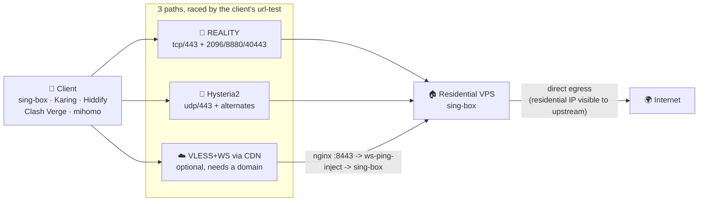
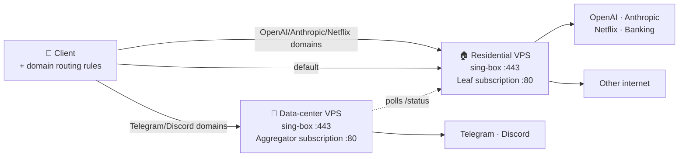

# anyreality-resi-stack

**面向国内网络的 sing-box 多路径自托管部署栈（住宅 IP 优先）**  
**Self-hosted, multi-path sing-box stack built for networks in China**

`anyreality-resi-stack`（前身 `reality-resi-stack`）是一个开源（GPL-3.0）、可审计的 **Bash 一键安装工具包**：在 **Ubuntu 22.04+ / Debian 12+** VPS 上部署 **sing-box**，默认同时开三条互补的接入路径 —— **VLESS + REALITY + Vision（TCP）**、**Hysteria2（UDP）**、**VLESS + WebSocket 经 CDN 中转（可选，需域名）**，由客户端自动赛跑选路；可选启用零依赖 Python 订阅服务、流量卡片与双节点域名分流。入口：[`install/install.sh`](install/install.sh)。

> **为什么是三条路而不是一条**：单一路径必然会在某条线路上失效，而且**失效时服务端完全看不出来**。
> 三条路径的失效原因互不相关 —— 完整论证、实测数据与测量方法见
> **[国内网络优化](docs/zh-CN/CHINA-NETWORK.md)**，这份文档是本项目的核心。

It is **not** a residential-IP vendor, multi-user panel, or commercial airport. You bring your own VPS; this repo configures it.

[](LICENSE)
[](docs/en/DEPLOYMENT.md)
[](https://sing-box.sagernet.org)
[](docs/zh-CN/CHINA-NETWORK.md)
[](https://github.com/qilaidev/anyreality-resi-stack/releases)

[English README](README.en.md) · [🇨🇳 国内网络优化](docs/zh-CN/CHINA-NETWORK.md) · [新手教程](docs/zh-CN/BEGINNER_GUIDE.md) · [命令示例](docs/zh-CN/EXAMPLES.md) · [FAQ](docs/zh-CN/FAQ.md) · [部署](docs/zh-CN/DEPLOYMENT.md) · [客户端](docs/zh-CN/CLIENTS.md) · [分流规则](docs/zh-CN/ROUTING.md) · [同类对比](docs/zh-CN/COMPARISON.md) · [llms.txt](llms.txt) · [Changelog](CHANGELOG.md)

---

## 项目定位 | What / why / who

| | 中文 | English |
|---|---|---|
| **是什么** | 自托管代理**部署栈**：安装器 + sing-box 模板 + Python 订阅服务 + 文档 | Self-hosted proxy **deployment stack**: installer, sing-box templates, Python subscription servers, docs |
| **解决什么** | 把自有住宅/普通 VPS 配成可导入客户端的节点；可选双节点把 OpenAI 等走住宅、Telegram/Discord 走数据中心 | Turn your VPS into an importable node; optional dual-node routes OpenAI-class traffic via residential egress and TG/Discord via DC |
| **适合谁** | 有 VPS、会 SSH、不想养 Web 面板的个人/小团队/AI 工具用户 | Owners of a VPS who prefer Bash+systemd over a panel |
| **默认协议** | **VLESS + REALITY + Vision** —— 唯一一个 sing-box 与 mihomo **都能写出来**的抗检测协议；论证见 [协议选型](#协议选型为什么默认不是-anyreality) | **VLESS + REALITY + Vision**; the only anti-detection protocol every client kernel can express |
| **抗封锁** | 三条路径（TCP / UDP / CDN）＋ 备用端口，客户端 urltest 自动选路 | Three paths (TCP / UDP / CDN) plus alternate ports, raced by the client |
| **技术栈** | Bash, sing-box, REALITY, Hysteria2, VLESS+WS, AnyTLS(可选), Python stdlib HTTP, systemd, UFW, fail2ban, nginx(CDN 路径) | same |
| **系统** | Ubuntu 22.04+/24.04, Debian 12+ | same |
| **入口路径** | `install/install.sh`；运行时 `/etc/sing-box/conf`, `/etc/anyreality-resi-stack/` | same |

**先知道的三件事：** ① 客户端配置自带国内直连/广告拦截等规则，且**全部规则集内嵌、启动期零网络请求**（远程规则集会让客户端在抖动线路上开机卡死，见 [国内网络优化 §3](docs/zh-CN/CHINA-NETWORK.md)）；② 订阅默认 **明文 HTTP :80**，URL 含节点密码，**等同凭证，勿外传**（[SECURITY.md](SECURITY.md#subscription-url-exposure--订阅地址的暴露面)）；③ CDN 中转路径需要你自己的域名和证书，不配也能用，但**裸 IP 被整段黑洞的线路（常见于移动/广电）只有这条路能通**。

## 快速开始 | Quick start

```bash
# 建议先 dry-run 预览（不改系统）
bash <(curl -fsSL https://raw.githubusercontent.com/qilaidev/anyreality-resi-stack/main/install/install.sh) \
  --node-name "US-Resi-01" --sni addons.mozilla.org --with-subscription --dry-run

# 确认无误后去掉 --dry-run 正式安装（默认 vless-reality + Hysteria2 + 备用端口）
bash <(curl -fsSL https://raw.githubusercontent.com/qilaidev/anyreality-resi-stack/main/install/install.sh) \
  --node-name "US-Resi-01" \
  --sni addons.mozilla.org \
  --with-subscription
```

安装器会：预检与内核调优/swap → 官方 apt 源装 sing-box（GPG 校验）→ 生成密钥与各路径口令 → 写 REALITY 入站（`:443`）＋ Hysteria2 入站（`udp:443`，自签证书并在订阅里钉住）→ 备用端口 NAT 重定向 → systemd / UFW / fail2ban → 可选 CDN 中转（nginx + WS 保活注入）→ 拉取并**内嵌**规则集、生成两种格式的订阅并做结构校验 → 自检。

想加 CDN 中转路径（裸 IP 被封时的唯一出路）：

```bash
... --cdn-domain relay.example.com --cdn-cert /path/fullchain.pem --cdn-key /path/key.pem
```

| 需求 | 做法 |
|---|---|
| 固定版本可重复部署 | `ANYREALITY_RESI_STACK_REF=<tag>` |
| 无人值守 | `--config FILE --non-interactive` |
| 第一次部署 | [新手教程](docs/zh-CN/BEGINNER_GUIDE.md) / [Beginner guide](docs/en/BEGINNER_GUIDE.md) |
| 更多命令 | [命令示例](docs/zh-CN/EXAMPLES.md) |

装完用完成卡上的订阅 URL（`http://<IP>/<TOKEN>/`）导入 **sing-box 系客户端**（SFA/SFI/SFM、Karing、Hiddify、NekoBox），再验证：

```bash
curl -x socks5h://127.0.0.1:2080 https://checkip.amazonaws.com   # 客户端侧，应等于 VPS 出口
curl -fsS http://<your-ip>/healthz                        # 订阅存活
systemctl status sing-box --no-pager
```

## 核心功能 | Core features

- **一行安装**：`install/install.sh`（`--dry-run` / `--non-interactive` / `--config` / 幂等重跑）
- **三条互补路径**：REALITY(TCP) ＋ Hysteria2(UDP) ＋ VLESS+WS 经 CDN（可选），客户端 urltest 自动选路
- **备用端口**：2096/8880/40443 用 NAT REDIRECT 打到主口，**sing-box 配置零改动**，干扰按端口分化时有得试
- **规则集全内嵌**：启动期零网络请求，杜绝「客户端一点就退」的开机死锁；服务端每周刷新
- **可选 AnyReality**：`--protocol anytls-reality`，填充更强，代价是没有 Clash 订阅
- **三态自适应订阅**：`subscription/leaf_server.py`（零依赖），一个 `/<TOKEN>/` 地址根据 User-Agent（或 `?format=singbox|clash|uris`）自动向 sing-box 系下发 `profile.json`、向 Clash/mihomo 系下发 `profile.yaml`（含 `packet-encoding: xudp`）、向 Shadowrocket/v2rayN/v2rayNG/Streisand 下发 Base64 全路径节点包 `profile.txt`，并支持 `/status`、`/healthz`、`Subscription-Userinfo` 流量卡片
- **服务端选择性 WARP 出站**：`--with-warp`（[WARP-EGRESS](docs/zh-CN/WARP-EGRESS.md)），在 `sing-box` 内挂载原生 WireGuard Endpoint (`warp-ep`) 与 10 级 C9 路由不变量，仅将弹 403/Turnstile 的 AI/社交域名及纯 AAAA 的 `challenges.cloudflare.com` 切入 WARP，保留 Google/Netflix/TikTok/网银 100% 原生住宅 IP 直出，并配每 2 分钟自愈 `warp-watchdog.timer`
- **开箱分流**：内网直连 → 广告拦截 → 国内直连（内联安全网 + 175 条常用国内 CDN 扩展 + geosite/geoip）→ 拦 UDP/443 → 其余走节点
- **双节点**：住宅承载 OpenAI/Anthropic/Netflix 等；数据中心承载 Telegram/Discord（[DUAL-NODE](docs/zh-CN/DUAL-NODE.md)）
- **运维默认**：systemd、UFW（含 Cloudflare IPv4/IPv6 官方回源白名单兜底）、fail2ban、BBR + UDP/QUIC 大缓冲与 GRO/GSO 卸载、双栈 `iptables`/`ip6tables` 端口重定向、swap、配置备份 timer、深度健康检查（含 C3 配置漂移与 C9 路由审计）
- **安全默认**：每机独立密钥；仓库 redact + hash denylist，禁止凭证入库

## 使用场景 | Use cases

| 场景 | 推荐 |
|---|---|
| 自有住宅 IP VPS，给 ChatGPT / Claude / 银行 / 流媒体用信誉出口 | 本项目单节点 + 订阅 |
| 住宅 IP 好用但 Telegram/Discord 上传卡、语音差 | [双节点智能分流](docs/zh-CN/DUAL-NODE.md) |
| 只要可审计、少暴露面的单用户节点，不要面板 | 本项目（无 Web 管理后台） |
| 多用户计费、到期、Web 面板 | 3x-ui / x-ui 更合适 |
| 必须 Clash/mihomo | 默认即可，无需任何额外参数 |
| Shadowrocket / v2rayN / v2rayNG | 同一个订阅 URL 自动返回 Base64 全路径 URI 订阅（或加 `?format=uris`） |
| 住宅 IP 偶发 Claude/ChatGPT/X 弹 403 或纯 IPv4 机器卡 Turnstile | 加 `--with-warp` 开启[服务端选择性 WARP 出站](docs/zh-CN/WARP-EGRESS.md)（不污染原生住宅 IP） |
| 移动/广电线路，裸 IP 连不上 | 配 `--cdn-domain` 开 CDN 中转路径 |

部署栈横向对比：[同类评分对比](docs/zh-CN/COMPARISON.md)。协议横向对比见下一节。

## 限制与注意事项 | Limits

- **不提供** VPS / 住宅 IP；**不做** 多用户计费、机场面板、K8s/Docker-only/OpenWRT/CentOS7
- **不承诺** 绕过账号风控、地区政策或协议检测
- `--protocol anytls-reality` **不支持** mihomo/多数 Clash（会明确拒绝生成 Clash 订阅）；订阅 URL **勿公开**
- CDN 中转路径需要**你自己的域名 + 证书 + CDN 账号**，本项目不提供
- 前身仓库名 `reality-resi-stack`（v1.x）会跳转到本仓；运行时前缀已统一为 `anyreality-resi-stack`，就地升级不丢密钥

**GitHub About 建议**：`Multi-path self-hosted sing-box stack for networks in China — REALITY + Hysteria2 + CDN relay, Bash installer, Python subscription, dual-node routing.`  
**Topics 建议**：`sing-box` `reality` `vless` `hysteria2` `cloudflare` `residential-ip` `proxy` `self-hosted` `subscription-server` `ubuntu` `debian` `systemd` `china` `anytls`

AI 检索摘要：[llms.txt](llms.txt) · 文档索引：[docs/README.md](docs/README.md)

## 协议选型：为什么默认不是 AnyReality

> **一句话结论：选协议的第一个问题不是「哪个快」，而是「我要覆盖的每个客户端内核，
> 都能把这个节点写出来吗」。** 本仓库因为先问了第二个问题，付出了一个月的代价。

### 那次教训

本仓库曾经默认 **AnyTLS + REALITY**，论证是充分的：自定义填充压 TLS-in-TLS 特征、
REALITY 补服务端伪装、无需域名证书、弱网实测优于 Trojan。**结论仍然错了。**

错的不是推理，是**选型时只看了服务端，没看客户端内核的覆盖面**：

> mihomo 的 `anytls` 配置块**没有 `reality-opts` 字段**，`public-key` / `short-id`
> 无处可填（[官方文档](https://wiki.metacubex.one/en/config/proxies/anytls/) ·
> [issue #2155](https://github.com/MetaCubeX/mihomo/issues/2155)）。
> Clash 系订阅里**主力节点根本写不出来**。

这个故障的形状值得记住：服务端全绿、`sing-box check` 通过、跑 sing-box 内核的用户
一切正常 —— **只有 Clash 用户没有主力节点，而且他们看到的是「列表里少了几个节点」，
不是任何报错**。从服务端看不出任何异常，所以它拖了一个月才被定位。

### 现在的默认

| | 默认 | 可选 |
|---|---|---|
| **协议** | `--protocol vless-reality`（VLESS + REALITY + xtls-rprx-vision） | `--protocol anytls-reality` |
| **客户端覆盖** | sing-box 系 ✅ · Clash / mihomo ✅ | sing-box 系 ✅ · Clash / mihomo ❌ |
| **抗检测** | REALITY 服务端伪装，无需域名证书 | REALITY ＋ AnyTLS 自定义填充（填充确实更强） |
| **订阅产物** | `profile.json` ＋ `profile.yaml` | **只有 `profile.json`** |

AnyReality 的填充特性是真实优势，它没有被删掉。但选它就**没有 Clash 订阅** ——
安装器会直接告诉你，`build_profile.py` 会拒绝生成 YAML 而不是生成一份残缺的。
这是刻意的：静默地少给一半用户一个节点，比明确报错糟糕得多。

### 30 秒决策树

```text
我的客户端里有 Clash / mihomo / Stash 吗？
  ├─ 有（或者不确定） → vless-reality（默认，别改）
  └─ 全是 sing-box 系，且我确定以后也不会加 Clash
        → 可以上 anytls-reality，换取更强的填充特性
           代价：订阅只有 JSON，将来加一个 Clash 用户就要重装

弱网高丢包、UDP 能通？        → Hysteria2 路径默认已开，不用选
裸 IP 被整段封（移动/广电）？  → 必须配 CDN 中转路径，见 CHINA-NETWORK.md
已有完整域名+证书+反代？      → Trojan/TLS 仍可用，但运维更重，本仓库不做
```

### 协议横向对照

评分场景固定为：**中国区用户 · 自建节点 · 要抗检测 · 尽量少域名证书运维**。
这是产品判断，不是实验室基准，也不是「保证不被检测」。

| 协议 | 客户端覆盖 | 抗检测 | 免域名证书 | 在本仓库的位置 |
|---|---|---|---|---|
| **VLESS + REALITY + Vision** | **sing-box ＋ mihomo** | 高（REALITY 伪装） | ✅ | **默认主力路径** |
| AnyTLS + REALITY | 仅 sing-box 系 | 更高（填充 ＋ 伪装） | ✅ | `--protocol anytls-reality` |
| **Hysteria2** | sing-box ＋ mihomo | 中（salamander 混淆） | 自签名证书即可（本仓库为你钉住） | **默认第二条路径**（UDP） |
| **VLESS + WebSocket + CDN** | sing-box ＋ mihomo | 中（CDN 可见明文 VLESS 头） | 需域名 ＋ 证书 | **可选第三条路径**，裸 IP 被封时唯一能通 |
| Trojan / 传统 TLS | 广 | 中 | ❌ 强依赖域名 + 真站 | 不做（运维面更大，无借指纹） |
| Shadowsocks 2022 | 广 | 低（TLS 层伪装弱） | ✅ | 不做 |
| VMess | 广 | 低（旧特征多） | ✅ | 不做 |

> **Hysteria2 不是 REALITY 的替代品，是另一条赛道。** 它走 UDP/QUIC：
> TCP 被针对性干扰时它常常还能通，而部分移动线路会整段封 UDP。
> 两条都要，正是因为它们的失效原因不相关。

### 三条路径各自什么时候是唯一能用的

| 路径 | 传输 | 它救命的场景 | 它废掉的场景 |
|---|---|---|---|
| REALITY | TCP 443 ＋ 2096/8880/40443 | 电信 / 联通多数线路，直连最快 | 移动 / 广电常见：SYN 通过、ClientHello 被丢 |
| Hysteria2 | UDP 443 ＋备用口 | TCP 被干扰、弱网高丢包 | 部分移动线路整段封 UDP |
| CDN 中转 | TCP 443 → CDN → 源站 | **裸 IP 被整段黑洞时的唯一出路** | 需域名；多一跳延迟 |

实测数据（西安联通 AS4837、绕开 TUN、交叉轮询）、为什么 `⚡ Auto` 里不放直连 REALITY、
优选 IP 怎么选、以及完整的测量方法论，全部在
**[国内网络优化](docs/zh-CN/CHINA-NETWORK.md)**。

### 上游跟进

协议生态、检测形势、客户端支持都会变。本仓库会按
[sing-box](https://sing-box.sagernet.org/) / REALITY / mihomo 上游变更调整默认与推荐，
并在 [Changelog](CHANGELOG.md) 记录。若某天 mihomo 补上了 `anytls` 的 `reality-opts`，
默认会重新评估 —— 但**判据仍然是「所有目标客户端内核都能写出来吗」，而不是单看性能**。

### 边界（避免过度承诺）

- 本项目**不承诺**绕过任何账号风控、地区政策或协议检测。
- 「多路径」提高的是**在某条线路失效时仍有一条能用的概率**，不是绝对可用性。
- 三条路径都需要你的 VPS 本身还活着；IP 被整段封且没配 CDN 域名时，本项目救不了你。

## 为什么需要这个项目 | Why this exists

多数 VLESS 安装器（3x-ui、x-ui、XHTTP-Installer 等）面向「便宜 VPS + 隐藏出口」。**住宅 IP VPS 相反**：你付更高价格，是因为 OpenAI / Anthropic / 银行 / Netflix 等看重出口信誉；但同一住宅段常被 Telegram / Discord 软降权（上传卡住、「正在发送…」）。

本项目的前提：**把住宅 IP 当资产**——信誉敏感流量走住宅，不友好的少数服务按域名旁路到数据中心备用节点。双节点变量与步骤见 [DUAL-NODE.md](docs/zh-CN/DUAL-NODE.md)。

## 装完之后 | After install

完成卡会打印节点信息、各路径的凭据（`vless://` 分享链接、Hysteria2 口令）、以及订阅 `http://<IP>/<SUB_TOKEN>/`。

> **优先用订阅，不要只导入那条 `vless://`。** 分享链接只描述「直连 REALITY」这一条路径，
> 拿不到 Hysteria2、CDN 中转、备用端口，也拿不到自动选路和内嵌的分流规则。

1. **拿配置**：优先订阅 URL（默认返回 sing-box `profile.json`）；占位样例见 `examples/single-node/sing-box-client-config.json`、`examples/dual-node/sing-box-client-dual.json`。
2. **导入客户端**：[CLIENTS.md](docs/zh-CN/CLIENTS.md)。手动字段：`type=anytls`、`server`、`port`、`password`、`tls.server_name`、`utls fingerprint=chrome`、`reality public_key` + `short_id`。
3. **验证**：客户端 `curl -x socks5h://127.0.0.1:2080 https://checkip.amazonaws.com`；服务器 `curl -fsS http://<ip>/healthz`、`systemctl status sing-box`。

排障：[TROUBLESHOOTING.md](docs/zh-CN/TROUBLESHOOTING.md)。

---

## 🏗️ Architecture | 架构

### Single-node (default) | 单节点（默认）



三条路径的失效原因互不相关：REALITY 死于 TCP 侧的 ClientHello 干扰，Hysteria2 死于整段封 UDP，
CDN 中转死于域名/证书缺失 —— 但它是**裸 IP 被黑洞时唯一还能通的**。
`⚡ Auto` 组的成员顺序、探测参数、以及为什么直连 REALITY 不在自动组里，
见 [国内网络优化 §4](docs/zh-CN/CHINA-NETWORK.md)。

### Dual-node with smart routing | 双节点 + 智能分流



Client downloads a *single* subscription URL from the aggregator. That URL returns a profile listing **both** nodes plus the routing rules, and the server picks the format from the client's User-Agent — sing-box JSON for SFA/Karing/Hiddify, Clash YAML for mihomo/Stash — so one URL works for a household that mixes both. Traffic accounting still reflects the residential node's quota (aggregator polls the leaf and caches the result, falling back gracefully if the leaf is briefly unreachable).

---

## 文档 | Documentation

| 中文 | English |
|---|---|
| [文档索引](docs/README.md) | [Documentation index](docs/README.md) |
| **[🇨🇳 国内网络优化](docs/zh-CN/CHINA-NETWORK.md)** | **[🇨🇳 Networks in China](docs/en/CHINA-NETWORK.md)** |
| [新手教程](docs/zh-CN/BEGINNER_GUIDE.md) | [Beginner guide](docs/en/BEGINNER_GUIDE.md) |
| [常见问题 FAQ](docs/zh-CN/FAQ.md) | [FAQ](docs/en/FAQ.md) |
| [命令示例](docs/zh-CN/EXAMPLES.md) | [Usage examples](docs/en/EXAMPLES.md) |
| [部署](docs/zh-CN/DEPLOYMENT.md) | [Deployment](docs/en/DEPLOYMENT.md) |
| [订阅服务设计](docs/zh-CN/SUBSCRIPTION.md) | [Subscription server design](docs/en/SUBSCRIPTION.md) |
| [双节点 + 智能分流](docs/zh-CN/DUAL-NODE.md) | [Dual-node + smart routing](docs/en/DUAL-NODE.md) |
| [分流规则](docs/zh-CN/ROUTING.md) | [Client routing rules](docs/en/ROUTING.md) |
| [故障排查](docs/zh-CN/TROUBLESHOOTING.md) | [Troubleshooting](docs/en/TROUBLESHOOTING.md) |
| [客户端导入](docs/zh-CN/CLIENTS.md) | [Client import](docs/en/CLIENTS.md) |
| [同类评分对比](docs/zh-CN/COMPARISON.md) | [Comparison](docs/en/COMPARISON.md) |

机器可读摘要（GEO / AI 检索）：[llms.txt](llms.txt)。

---

## 安全 | Security

- 密钥每机本地生成；CI 哈希 denylist + 形态检测，凭证不得入库
- sing-box apt 源固定 GPG 指纹，不匹配则拒绝安装
- 威胁模型与上报：[SECURITY.md](SECURITY.md)

> ⚠️ **订阅 URL = 凭证。** 默认明文 HTTP `:80`，返回配置含节点密码。勿贴 issue/截图/群聊；勿把备份放进 `FILE_DIR`。可加 TLS 反代，或 `scp` 取一次后关订阅。

---

## ❓ FAQ

下面是最高频的几个问题。更完整的问答（安装参数、订阅安全、流量统计、分流行为、双节点、卸载、许可边界等 40+ 条）见 [常见问题 FAQ](docs/zh-CN/FAQ.md) / [FAQ (English)](docs/en/FAQ.md)。

**Q: 我的 Telegram 在住宅 VPS 上文件上传卡死、"正在发送..." 一直转,怎么办?**
Telegram 会对**历史上跑过 bot 的住宅 IP 段**做软降权。打开本仓库的**双节点模式**,把 `geosite:telegram` 通过数据中心备用节点出去,问题立刻解决。

**Q: OpenAI / ChatGPT 在数据中心 VPS 上提示 "unsupported region",换住宅 VPS 就好了 —— 但 Telegram 又变慢。怎么两个都顾?**
这就是这个项目存在的全部理由:**OpenAI / Anthropic / 银行 / Netflix 走住宅出口,Telegram / Discord 走数据中心节点**,客户端只看到一份订阅。

**Q: 默认协议是什么?为什么不是 AnyReality?**
默认是 **VLESS + REALITY + xtls-rprx-vision**,因为它是唯一一个 **sing-box 和 mihomo 都能写出来**的抗检测协议。AnyReality 的填充确实更强,但 mihomo 的 `anytls` 块没有 `reality-opts` 字段——Clash 订阅里那个节点根本写不出来,而**服务端全绿、sing-box 用户一切正常,从服务端看不出任何异常**。这个坑让本项目付出了一个月。仍然想要填充特性、且确定所有客户端都是 sing-box 系,用 `--protocol anytls-reality`,安装器会明确告诉你没有 Clash 订阅。完整论证见 [协议选型](#协议选型为什么默认不是-anyreality)。

**Q: 我的线路裸 IP 连不上(移动/广电),换端口也没用,怎么办?**
配 **CDN 中转路径**:`--cdn-domain relay.example.com --cdn-cert … --cdn-key …`,把域名挂到 Cloudflare 这类 CDN 上开代理。这是裸 IP 被整段黑洞时**唯一还能通的路**。注意源站端口不能是 443(sing-box 占着,而且 REALITY 会把非代理流量原样转走),安装器只接受 CDN 支持 HTTPS 回源的那几个端口。还有一个坑:CDN 会在约 100 秒无帧后关闭被代理的 WebSocket,TCP keepalive 是逐跳的、根本传不到 CDN——本项目在源站注入应用层 WS ping 解决,细节见 [国内网络优化 §5](docs/zh-CN/CHINA-NETWORK.md)。

**Q: 客户端一点就退 / 开机起不来,重启电脑有时候好,是什么?**
几乎一定是**远程规则集把启动锁死在了代理上**:sing-box 启动时必须先下载完所有 `type: remote` 规则集,失败就 FATAL 退出;而下载走的代理组在冷启动时还没有测速结果,只能取第一个成员——那个成员在你这条线上是死的。本项目下发的订阅**规则集全部内嵌,启动期零网络请求**,物理上不可能因下载失败而起不来。如果还在发生,先检查客户端里有没有留着**已下线服务器的旧订阅**,它会把这个环带回来。排查:`grep -c raw.githubusercontent <客户端 kernel.log>`。

**Q: 刚导入订阅,连国内网站(淘宝、微信、B 站、网银)都变得又慢又卡,是节点问题吗?**
不是。TUN 模式下**没有"全局/直连"开关,流量走不走代理完全由规则决定**,规则不完善就会把国内流量也发去海外。本项目下发的客户端配置**自带四层分流规则**(内网直连 → 广告拦截 → 国内直连 → 兜底走节点),导入即用。如果你手改过配置或用了别处的模板,对照 [分流规则](docs/zh-CN/ROUTING.md) 检查。另外注意:`geosite-cn` 规则集要从 GitHub 下载,首次启动下不来就会整个失效 —— 所以本项目在它前面额外内联了一份约 60 条的国内域名安全网,不依赖任何网络请求。

**Q: 订阅 URL 是 HTTPS 吗?能公开分享吗?**
不是 HTTPS,是**明文 HTTP :80**;而且返回的配置里含节点密码。**拿到 URL 就等于拿到你的节点**,绝对不要公开分享、贴进 issue 或截图。要加密就自己在前面加一层 TLS 反代,或者用 `scp` 取一次配置后把订阅服务关掉。另外别把备份文件放进 `FILE_DIR`,同一个 token 路径会把它一起下发出去。详见 [SECURITY.md](SECURITY.md#subscription-url-exposure--订阅地址的暴露面)。

**Q: Reality 协议需要域名和证书吗?**
REALITY 和 Hysteria2 路径都不需要——这是相对 Trojan / V2Ray-TLS 的最大优势。默认伪装 SNI 是 `addons.mozilla.org`,可换成任何高信誉域名。Hysteria2 用安装器生成的自签名证书,并把它**钉在订阅里**(而不是让客户端 `skip-cert-verify`),所以既不需要域名,也没有放宽校验。**只有可选的 CDN 中转路径需要你自己的域名和证书。**

**Q: 默认配置为什么把 UDP 443 (QUIC / HTTP3) 拦掉了?**
REALITY 和 CDN 中转都是纯 TCP,这部分 QUIC 流量没法走。不拦的话浏览器会一直尝试 HTTP/3、超时后才回落 TCP,表现就是"打开网页前先卡几秒"。拦掉 `udp:443` 是让它**立刻**回落。注意这条规则匹配的是**客户端流量**,不是隧道本身——Hysteria2 自己走 UDP,完全不受影响。想放行就装的时候加 `--allow-quic`。

**Q: 这工具和 3x-ui / x-ui / XHTTP-Installer 有什么区别?**
那些是为「便宜 VPS 翻墙」设计的(多用户、面板、隐藏出口 IP)。本项目是为**住宅 IP VPS 是资产**这个完全相反的前提设计的 —— 默认单 UUID、不藏 IP、按域名把对住宅 IP 不友好的少数服务旁路掉。

其余问题 —— 安装脚本幂等性、为什么只支持 Ubuntu 22.04+ / Debian 12+、如何固定版本与无人值守安装、订阅 URL 找回、流量统计口径、双节点部署、卸载与回滚、GPL-3.0 商用边界 —— 见 [完整 FAQ](docs/zh-CN/FAQ.md)。

## 🤝 Contributing | 贡献

PRs welcome. Read [CONTRIBUTING.md](CONTRIBUTING.md) first — lint gates are strict, and any change touching install scripts must pass `make test && make lint && make redact && make examples`.

欢迎 PR。请先看 [CONTRIBUTING.md](CONTRIBUTING.md)；安装脚本相关改动必须通过 `make test && make lint && make redact && make examples`。

---

## 📜 License

GPL-3.0. See [LICENSE](LICENSE).

## Star History

[](https://www.star-history.com/#qilaidev/anyreality-resi-stack&Date)

---

## Architecture & Ecosystem · qilai (`qilaidav.com`)

This repository is part of the **[qilai · qilaidav](https://qilaidav.com/)** deterministic systems engineering matrix:

- **Corresponding Architecture Pillar**: [手机自动化矩阵与边缘防关联基础设施 (Mobile Matrix & Edge Infrastructure)](https://qilaidav.com/cloud-matrix/)
- **Studio Website (ZH / EN)**: [https://qilaidav.com/](https://qilaidav.com/) · [https://qilaidav.com/en/](https://qilaidav.com/en/)
- **Production Field Reports & Technical Notes**: [https://qilaidav.com/notes/](https://qilaidav.com/notes/)
- **Direct Architect Contact (Telegram)**: [@BD8888](https://t.me/BD8888)
- **Public Technical Channel (Telegram)**: [@AIKB8 · AI资源笔记](https://t.me/AIKB8)
- **Email**: [hello@qilaidav.com](mailto:hello@qilaidav.com)

